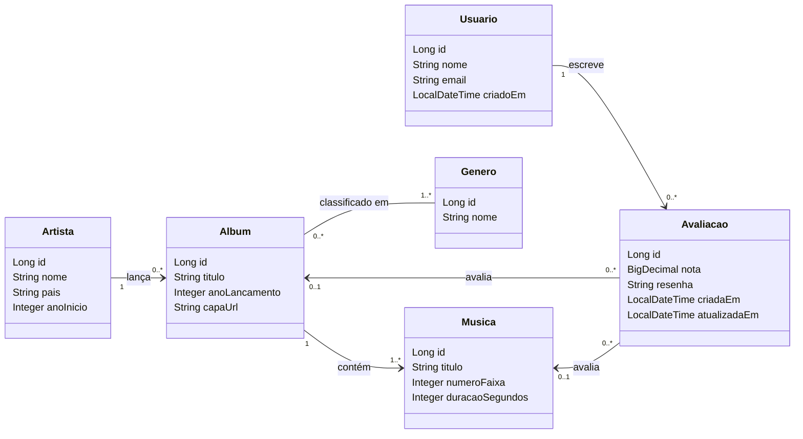

# API de Avaliação Musical

API REST para avaliar álbuns e músicas. O usuário registra o que ouviu, dá uma nota e escreve uma resenha. A ideia segue o modelo do Letterboxd, aplicado à música.

Projeto final da disciplina de API REST. O enunciado está em [docs/enunciado-projeto-final.md](docs/enunciado-projeto-final.md). O catálogo de cartas-desafio está em [docs/cartas-desafio.md](docs/cartas-desafio.md).

## Tema

**Entretenimento e Cultura.**

## Integrantes

| Integrante | Papel |
| --- | --- |
| Gabriel de Oliveira Rodrigues | Modelagem, implementação, testes e documentação |

## Problema

Quem ouve música não tem um lugar central para registrar e comparar opiniões sobre álbuns e faixas. As plataformas de streaming tocam a música, mas guardam pouca opinião do ouvinte. A avaliação de um álbum inteiro também é diferente da avaliação de cada faixa.

A API resolve isso com estas funções:

- registrar artistas, álbuns, músicas e gêneros;
- permitir que cada usuário avalie álbuns e músicas com nota e resenha;
- listar e ordenar álbuns e músicas por nota média, ano e gênero;
- consultar o histórico de avaliações de cada usuário.

## Domínio

| Entidade | Descrição |
| --- | --- |
| Artista | Pessoa ou banda que lança álbuns. |
| Álbum | Lançamento de um artista. Tem título, ano, capa e um ou mais gêneros. |
| Música | Faixa de um álbum. Tem título, número da faixa e duração. |
| Gênero | Classificação musical, por exemplo rock, jazz ou MPB. |
| Usuário | Pessoa que avalia álbuns e músicas. |
| Avaliação | Nota e resenha de um usuário sobre um álbum ou sobre uma música. |

### Relacionamentos

| Relacionamento | Cardinalidade | Regra |
| --- | --- | --- |
| Artista → Álbum | 1:N | Um artista tem vários álbuns. Um álbum pertence a um artista. |
| Álbum → Música | 1:N | Um álbum tem várias músicas. Uma música pertence a um álbum. |
| Álbum ↔ Gênero | N:N | Um álbum tem vários gêneros. Um gênero classifica vários álbuns. |
| Usuário → Avaliação | 1:N | Um usuário faz várias avaliações. |
| Álbum → Avaliação | 1:N | Um álbum recebe várias avaliações. |
| Música → Avaliação | 1:N | Uma música recebe várias avaliações. |

### Regras de negócio

- A nota vai de 0,5 a 5, em passos de 0,5.
- Cada avaliação aponta para um álbum **ou** para uma música. A avaliação nunca aponta para os dois ao mesmo tempo.
- Cada usuário avalia o mesmo álbum uma vez só. A mesma regra vale para a música.
- O número da faixa é único dentro do álbum.
- O e-mail do usuário é único.

## Diagrama UML inicial

> **Nota:** este é o modelo inicial da entrega E1. O modelo pode mudar na API base e na carta-desafio. Cada mudança fica registrada neste README.

## Cronograma de entregas

| Entrega | Data | Conteúdo | Situação |
| --- | --- | --- | --- |
| E1 | 19/11 | Repositório, tema, integrantes, problema, domínio e UML inicial | Entregue |
| E2 | 26/11 | API base com CRUD e requisitos obrigatórios | Pendente |
| E3 | 03/12 | Carta-desafio, requisitos extras, slides e evidências | Pendente |

## Tecnologias

A stack é definida na entrega E2.

## Como executar

As instruções de execução entram na entrega E2.
