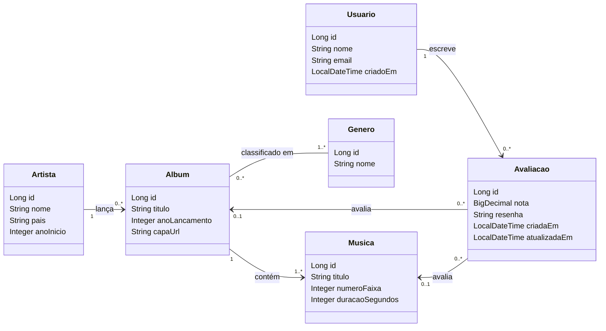

# API de Avaliação Musical

API REST para avaliar álbuns e músicas. O usuário registra o que ouviu, dá uma nota e escreve uma resenha. A ideia segue o modelo do Letterboxd, aplicado à música.

Projeto final da disciplina de API REST. O enunciado está em [docs/enunciado-projeto-final.md](docs/enunciado-projeto-final.md). O catálogo de cartas-desafio está em [docs/cartas-desafio.md](docs/cartas-desafio.md).

## Tema

**Entretenimento e Cultura.**

## Integrantes

| Integrante | Papel |
| --- | --- |
| Gabriel de Oliveira Rodrigues | Modelagem, implementação, testes e documentação |

## Problema

Quem ouve música não tem um lugar central para registrar e comparar opiniões sobre álbuns e faixas. As plataformas de streaming tocam a música, mas guardam pouca opinião do ouvinte. A avaliação de um álbum inteiro também é diferente da avaliação de cada faixa.

A API resolve isso com estas funções:

- registrar artistas, álbuns, músicas e gêneros;
- permitir que cada usuário avalie álbuns e músicas com nota e resenha;
- listar e ordenar álbuns e músicas por nota média, ano e gênero;
- consultar o histórico de avaliações de cada usuário.

## Domínio

| Entidade | Descrição |
| --- | --- |
| Artista | Pessoa ou banda que lança álbuns. |
| Álbum | Lançamento de um artista. Tem título, ano, capa e um ou mais gêneros. |
| Música | Faixa de um álbum. Tem título, número da faixa e duração. |
| Gênero | Classificação musical, por exemplo rock, jazz ou MPB. |
| Usuário | Pessoa que avalia álbuns e músicas. |
| Avaliação | Nota e resenha de um usuário sobre um álbum ou sobre uma música. |

### Relacionamentos

| Relacionamento | Cardinalidade | Regra |
| --- | --- | --- |
| Artista → Álbum | 1:N | Um artista tem vários álbuns. Um álbum pertence a um artista. |
| Álbum → Música | 1:N | Um álbum tem várias músicas. Uma música pertence a um álbum. |
| Álbum ↔ Gênero | N:N | Um álbum tem vários gêneros. Um gênero classifica vários álbuns. |
| Usuário → Avaliação | 1:N | Um usuário faz várias avaliações. |
| Álbum → Avaliação | 1:N | Um álbum recebe várias avaliações. |
| Música → Avaliação | 1:N | Uma música recebe várias avaliações. |

### Regras de negócio

- A nota vai de 0,5 a 5, em passos de 0,5.
- Cada avaliação aponta para um álbum **ou** para uma música. A avaliação nunca aponta para os dois ao mesmo tempo.
- Cada usuário avalia o mesmo álbum uma vez só. A mesma regra vale para a música.
- O número da faixa é único dentro do álbum.
- O e-mail do usuário é único.

## Diagrama UML inicial



> **Nota:** este é o modelo inicial da entrega E1. O modelo pode mudar na API base e na carta-desafio. Cada mudança fica registrada neste README.
>
> **E2:** o modelo foi implementado como está no diagrama. A única adição é o campo `notaMedia` nas respostas de álbum e música, que é calculado a partir das avaliações e não fica salvo no banco. Por isso a ordenação por nota média ainda não está disponível no `sort`; a listagem de avaliações pode ser ordenada por `nota`.

## Cronograma de entregas

| Entrega | Data | Conteúdo | Situação |
| --- | --- | --- | --- |
| E1 | 19/11 | Repositório, tema, integrantes, problema, domínio e UML inicial | Entregue |
| E2 | 26/11 | API base com CRUD e requisitos obrigatórios | Entregue |
| E3 | 03/12 | Carta-desafio, requisitos extras, slides e evidências | Pendente |

## Tecnologias

- Java 17
- Spring Boot 4.1.1 (Web MVC, Data JPA, Validation)
- springdoc-openapi 3.1.1 (Swagger UI e OpenAPI 3)
- Spring Boot Actuator e Micrometer (health check, informações e métricas)
- H2 Database em arquivo (`./data/musica`), banco padrão
- PostgreSQL 17 com o profile `postgres` (driver `org.postgresql:postgresql`)
- Testcontainers (testes contra um PostgreSQL de verdade no Docker)
- Docker e Docker Compose (API + PostgreSQL com um comando)
- Maven

## Como executar

Há duas formas: com **Docker**, que não precisa de Java nem de banco instalados e sobe a API com PostgreSQL, ou **localmente**, com JDK e H2.

### Executar com Docker

> Requisito extra: **Docker/Compose (5%)**, issue [#4](https://github.com/gabrieldorodrigues/apirest-2026/issues/4).

Pré-requisito: [Docker Desktop](https://www.docker.com/products/docker-desktop/) aberto, com a engine rodando.

```bash
docker compose up --build
```

O `docker-compose.yml` sobe dois serviços:

| Serviço | Imagem | Porta | O que faz |
| --- | --- | --- | --- |
| `db` (`musica-db`) | `postgres:17-alpine` | 5432 | PostgreSQL com os dados no volume `musica-pgdata` |
| `api` (`musica-api`) | construída pelo `Dockerfile` | 8080 | A API com o profile `postgres`, conectada ao serviço `db` |

Como funciona:

- O **`Dockerfile`** é *multi-stage*. A primeira etapa compila o `.jar` com Maven e JDK 17. A imagem final leva só o JRE 17 (Alpine) e o `.jar`, roda com um usuário sem root e tem um `HEALTHCHECK` que consulta o `/actuator/health`;
- A API só sobe depois que o PostgreSQL aceita conexões (`depends_on` com `condition: service_healthy` e `pg_isready` no `db`);
- `docker compose ps` mostra os dois serviços como `healthy`;
- Os dados ficam no volume `musica-pgdata` e sobrevivem a um `docker compose down`. Os logs da API ficam no volume `musica-logs`;
- Os containers usam o fuso `America/Sao_Paulo`.

Comandos úteis:

```bash
docker compose ps                     # situação dos serviços
docker compose logs -f api            # logs da API
docker compose down                   # para tudo e mantém os dados
docker compose down -v                # para tudo e apaga os dados (o seed roda de novo)
docker exec -it musica-db psql -U musica -d musica   # entra no PostgreSQL
```

Para trocar as portas ou as credenciais, copie o `.env.example` para `.env` e ajuste `API_PORT`, `DB_PORT`, `POSTGRES_DB`, `POSTGRES_USER` e `POSTGRES_PASSWORD`. Por exemplo, `API_PORT=8081` se a 8080 já estiver em uso.

Evidência: [23-docker-compose-ps](evidencias/23-docker-compose-ps.png).

### Executar localmente

Pré-requisito: JDK 17 ou superior instalado.

**Pelo IntelliJ:** abra a pasta do projeto, espere o Maven baixar as dependências e rode a classe `MusicaApplication`.

**Pelo terminal (Linux / macOS):**

```bash
./mvnw spring-boot:run
```

A API sobe em `http://localhost:8080`. Na primeira execução o banco é criado em `./data/` e um seed cadastra gêneros, artistas, álbuns, músicas, usuários e avaliações de exemplo. Para voltar ao estado inicial, é só apagar a pasta `data/`.

A documentação interativa fica em `http://localhost:8080/swagger-ui.html` (veja [Documentação Swagger/OpenAPI](#documentação-swaggeropenapi)).

Para rodar os testes: pelo IntelliJ, clique com o botão direito em `src/test/java` e escolha **Run 'All Tests'**; pelo terminal, `./mvnw test`. Mais detalhes em [Testes automatizados](#testes-automatizados).

### Variáveis de ambiente

Todas são opcionais. Sem elas, a API usa o H2 local.

| Variável | Padrão (H2) | Padrão com o profile `postgres` | Descrição |
| --- | --- | --- | --- |
| `SPRING_PROFILES_ACTIVE` | (vazio) | `postgres` | Ativa o PostgreSQL |
| `DB_URL` | `jdbc:h2:file:./data/musica` | `jdbc:postgresql://localhost:5432/musica` | URL JDBC do banco |
| `DB_USER` | `sa` | `musica` | Usuário do banco |
| `DB_PASSWORD` | (vazio) | `musica` | Senha do banco |

### Executar com PostgreSQL

> Requisito extra: **SGBD diferente do H2 (5%)**, issue [#3](https://github.com/gabrieldorodrigues/apirest-2026/issues/3).

A API também roda em **PostgreSQL**. A troca é feita pelo profile `postgres` do Spring (`application-postgres.properties`), sem mudar nenhuma linha do código de domínio: as mesmas entidades, consultas JPQL e regras funcionam nos dois bancos. O H2 continua como padrão para desenvolvimento e para os testes.

1. Suba um PostgreSQL. Uma opção é o `docker compose up -d db`, que sobe só o banco do [Compose](#executar-com-docker). Outra é um container avulso:

   ```bash
   docker run -d --name musica-postgres -e POSTGRES_DB=musica -e POSTGRES_USER=musica -e POSTGRES_PASSWORD=musica -p 5432:5432 postgres:17-alpine
   ```

2. Rode a API com o profile `postgres`:
   - **IntelliJ:** em **Run → Edit Configurations → MusicaApplication**, preencha **Active profiles** com `postgres` (ou a variável de ambiente `SPRING_PROFILES_ACTIVE=postgres`);
   - **Terminal:** `SPRING_PROFILES_ACTIVE=postgres ./mvnw spring-boot:run`.

3. Na primeira execução o Hibernate cria as tabelas e o seed grava os dados de exemplo. `GET /actuator/health` mostra `"database": "PostgreSQL"`.

Para conferir os dados direto no banco:

```bash
docker exec -it musica-postgres psql -U musica -d musica -c "\dt"
docker exec -it musica-postgres psql -U musica -d musica -c "select titulo, ano_lancamento from albuns;"
```

Para usar outro servidor PostgreSQL, informe `DB_URL`, `DB_USER` e `DB_PASSWORD`. O console do H2 fica desligado nesse profile.

A compatibilidade é garantida por testes: o `PostgresIntegracaoTest` usa o **Testcontainers** para subir um PostgreSQL 17 no Docker durante o `./mvnw test` e roda a API contra ele (veja [Testes automatizados](#testes-automatizados)).

Evidências: [20-postgres-health](evidencias/20-postgres-health.png), [21-postgres-dados](evidencias/21-postgres-dados.png) e [22-testes-postgres](evidencias/22-testes-postgres.png).

### Console do H2

Disponível em `http://localhost:8080/h2-console` com a JDBC URL `jdbc:h2:file:./data/musica`, usuário `sa` e senha vazia.

## Estrutura do projeto

O código segue a arquitetura em camadas: o controller recebe a requisição, o service aplica as regras de negócio e o repository conversa com o banco.

```text
src/main/java/com/example/musica
├── config        # SeedConfig com os dados iniciais, OpenApiConfig (Swagger) e RequestLoggingFilter (log das requisições)
├── controller    # endpoints REST
├── dto           # records de entrada (RequestDto) e saída (ResponseDto)
├── exception     # exceções e ApiExceptionHandler
├── mapper        # conversão entidade -> DTO
├── model         # entidades JPA
├── repository    # interfaces Spring Data JPA
└── service       # regras de negócio
```

Na raiz ficam o `Dockerfile`, o `docker-compose.yml` e o `.env.example` (veja [Executar com Docker](#executar-com-docker)).

## Endpoints

Todas as entidades têm CRUD completo:

| Método | Rota | Descrição | Sucesso |
| --- | --- | --- | --- |
| GET | `/{recurso}` | Lista com paginação, filtros e ordenação | 200 |
| GET | `/{recurso}/{id}` | Busca por id | 200 |
| POST | `/{recurso}` | Cria | 201 |
| PUT | `/{recurso}/{id}` | Atualiza | 200 |
| DELETE | `/{recurso}/{id}` | Remove | 204 |

Recursos: `/artistas`, `/generos`, `/albuns`, `/musicas`, `/usuarios` e `/avaliacoes`.

A collection do Postman com todas as requisições está em [postman/collections/apirest-2026](postman/collections/apirest-2026), no formato v3 (YAML). Para usar, abra a pasta raiz do repositório no Postman (Local Mode). Cada pasta da collection é um diretório e cada requisição é um arquivo `.request.yaml`.

## DTOs

Cada entidade tem um DTO de entrada (`RequestDto`) e um de saída (`ResponseDto`). As entidades JPA nunca são expostas diretamente.

| Entidade | Entrada | Saída |
| --- | --- | --- |
| Artista | `nome`, `pais`, `anoInicio` | `id`, `nome`, `pais`, `anoInicio` |
| Gênero | `nome` | `id`, `nome` |
| Álbum | `titulo`, `anoLancamento`, `capaUrl`, `artistaId`, `generoIds` | `id`, `titulo`, `anoLancamento`, `capaUrl`, `artista` (objeto), `generos` (lista), `notaMedia` |
| Música | `titulo`, `numeroFaixa`, `duracaoSegundos`, `albumId` | `id`, `titulo`, `numeroFaixa`, `duracaoSegundos`, `albumId`, `albumTitulo`, `notaMedia` |
| Usuário | `nome`, `email` | `id`, `nome`, `email`, `criadoEm` |
| Avaliação | `usuarioId`, `albumId` **ou** `musicaId`, `nota`, `resenha` | `id`, `usuarioId`, `usuarioNome`, `albumId`/`albumTitulo` ou `musicaId`/`musicaTitulo`, `nota`, `resenha`, `criadaEm`, `atualizadaEm` |

Os campos `id`, `criadoEm`, `criadaEm`, `atualizadaEm` e `notaMedia` são gerados pela API. A `notaMedia` é a média das avaliações do álbum ou da música (fica `null` quando ainda não há avaliação).

Exemplo de entrada (`POST /albuns`):

```json
{
  "titulo": "Racional Vol. 1",
  "anoLancamento": 1975,
  "artistaId": 5,
  "generoIds": [3, 6]
}
```

Exemplo de saída:

```json
{
  "id": 5,
  "titulo": "Racional Vol. 1",
  "anoLancamento": 1975,
  "capaUrl": null,
  "artista": { "id": 5, "nome": "Tim Maia", "pais": "Brasil", "anoInicio": 1959 },
  "generos": [ { "id": 3, "nome": "MPB" }, { "id": 6, "nome": "Soul" } ],
  "notaMedia": null
}
```

## Validação e tratamento de erros

A validação dos campos usa Bean Validation (`@NotBlank`, `@NotNull`, `@Size`, `@Email`, `@Min`, `@Max`, `@Positive`, `@DecimalMin`, `@DecimalMax`) nos DTOs de entrada. As regras de negócio ficam nos services.

Os erros são tratados no `ApiExceptionHandler` e sempre retornam no formato Problem Details (RFC 9457):

| Código | Quando acontece |
| --- | --- |
| 400 | Campo obrigatório vazio, formato inválido, nota fora de 0,5 a 5, JSON mal formatado, id inválido na rota, campo de `sort` inexistente |
| 404 | Recurso não existe (inclusive ids informados no corpo, como `artistaId` ou `generoIds`) |
| 409 | E-mail repetido, gênero repetido, número de faixa repetido no álbum, usuário avaliando o mesmo álbum/música duas vezes, remoção de registro que tem dependentes |
| 422 | Avaliação com álbum e música ao mesmo tempo (ou sem nenhum dos dois), nota fora do passo de 0,5 |
| 500 | Erro inesperado (a mensagem não expõe detalhes internos) |

Regras de remoção: não dá para remover artista com álbuns, álbum com músicas ou avaliações, música com avaliações, usuário com avaliações e gênero usado por álbuns. Nesses casos a API retorna 409.

Exemplo de 400 (`POST /usuarios` com `{"nome":"","email":"nao-e-email"}`):

```json
{
  "title": "Erro de validação",
  "status": 400,
  "detail": "Um ou mais campos são inválidos",
  "instance": "/usuarios",
  "errors": {
    "nome": "O nome é obrigatório",
    "email": "O e-mail é inválido"
  }
}
```

Exemplo de 404:

```json
{
  "title": "Recurso não encontrado",
  "status": 404,
  "detail": "Álbum com id 999 não existe",
  "instance": "/albuns/999"
}
```

Exemplo de 409:

```json
{
  "title": "Conflito",
  "status": 409,
  "detail": "Este usuário já avaliou este álbum",
  "instance": "/avaliacoes"
}
```

Exemplo de 422:

```json
{
  "title": "Regra de negócio violada",
  "status": 422,
  "detail": "A avaliação deve ser de um álbum ou de uma música, nunca dos dois",
  "instance": "/avaliacoes"
}
```

## Paginação, filtros e ordenação

Todos os endpoints de listagem aceitam os parâmetros do Spring Data:

| Parâmetro | Descrição | Padrão |
| --- | --- | --- |
| `page` | Número da página, começando em 0 | `0` |
| `size` | Itens por página | `10` |
| `sort` | Campo e direção, ex.: `sort=anoLancamento,desc`. Pode repetir para ordenar por mais de um campo | depende do recurso |

Filtros de cada recurso (todos opcionais e combináveis):

| Recurso | Filtros | Ordenação padrão |
| --- | --- | --- |
| `/artistas` | `nome`, `pais` (contém, sem diferenciar maiúsculas) | `nome` |
| `/generos` | `nome` (contém) | `nome` |
| `/albuns` | `titulo` (contém), `ano`, `artistaId`, `generoId` | `titulo` |
| `/musicas` | `titulo` (contém), `albumId` | `numeroFaixa` |
| `/usuarios` | `nome`, `email` (contém) | `nome` |
| `/avaliacoes` | `usuarioId`, `albumId`, `musicaId`, `notaMinima` | `criadaEm` |

O filtro `usuarioId` em `/avaliacoes` mostra o histórico de avaliações de um usuário.

Exemplo: `GET /albuns?page=0&size=2&sort=anoLancamento,desc`

```json
{
  "content": [
    {
      "id": 2,
      "titulo": "In Rainbows",
      "anoLancamento": 2007,
      "capaUrl": null,
      "artista": { "id": 1, "nome": "Radiohead", "pais": "Reino Unido", "anoInicio": 1985 },
      "generos": [ { "id": 2, "nome": "Alternativo" }, { "id": 1, "nome": "Rock" } ],
      "notaMedia": 4.0
    },
    {
      "id": 1,
      "titulo": "OK Computer",
      "anoLancamento": 1997,
      "capaUrl": null,
      "artista": { "id": 1, "nome": "Radiohead", "pais": "Reino Unido", "anoInicio": 1985 },
      "generos": [ { "id": 2, "nome": "Alternativo" }, { "id": 1, "nome": "Rock" } ],
      "notaMedia": 4.75
    }
  ],
  "page": { "size": 2, "number": 0, "totalElements": 4, "totalPages": 2 }
}
```

Outros exemplos:

- `GET /albuns?artistaId=1&generoId=2` – álbuns do Radiohead no gênero Alternativo;
- `GET /musicas?albumId=1&sort=numeroFaixa` – faixas do OK Computer em ordem;
- `GET /avaliacoes?notaMinima=4.5&sort=nota,desc` – avaliações com nota 4,5 ou mais, da maior para a menor;
- `GET /artistas?pais=brasil` – artistas do Brasil.

## Documentação Swagger/OpenAPI

> Requisito extra: **Swagger/OpenAPI (5%)**, issue [#1](https://github.com/gabrieldorodrigues/apirest-2026/issues/1).

A documentação é gerada automaticamente pelo **springdoc-openapi** a partir dos controllers e DTOs. Com a API rodando:

| Endereço | O que é |
| --- | --- |
| `http://localhost:8080/swagger-ui.html` | Swagger UI: lista todos os endpoints e permite testá-los pelo navegador (**Try it out**) |
| `http://localhost:8080/v3/api-docs` | Especificação OpenAPI 3 em JSON, que pode ser importada no Postman ou em outras ferramentas |

O que está documentado:

- **Seções na ordem do domínio:** Artistas, Gêneros, Álbuns, Músicas, Usuários e Avaliações (`@Tag`);
- **Cada operação** tem resumo e descrição com as regras de negócio (`@Operation`). Por exemplo, `POST /avaliacoes` explica que a avaliação é de um álbum **ou** de uma música, que a nota vai de 0,5 a 5 em passos de 0,5 e que cada usuário avalia o mesmo item uma vez só;
- **Respostas possíveis de cada endpoint** (`@ApiResponse`): 200/201/204 e os erros 400, 404, 409 e 422 que aquele endpoint pode retornar. Todos os erros mostram o corpo **Problem Details** (`application/problem+json`) com um exemplo do próprio caso;
- **Filtros, paginação e ordenação** (`page`, `size`, `sort`) aparecem como parâmetros, com descrição e exemplo (`@Parameter` e `@ParameterObject`);
- **DTOs de entrada** com exemplos que usam os dados do seed (`@Schema`). O **Try it out** já abre com um corpo válido: em `POST /avaliacoes`, o exemplo cria a avaliação do João para o OK Computer (201), e executar de novo retorna 409;
- **Validações** (`@NotNull`, `@Size`, `@DecimalMin`, `@DecimalMax`...) aparecem no schema como campos obrigatórios, mínimos e máximos.

A configuração fica em `OpenApiConfig` (título, descrição, versão, ordem das seções e o schema de erro) e em `application.properties` (`springdoc.*`).

Evidências: [15-swagger-ui](evidencias/15-swagger-ui.png) e [16-swagger-try-it-out](evidencias/16-swagger-try-it-out.png).

## Observabilidade

> Requisito extra: **Observabilidade: health check, Actuator, métricas e logs (5%)**, issue [#2](https://github.com/gabrieldorodrigues/apirest-2026/issues/2).

A API usa o **Spring Boot Actuator** com **Micrometer**. Com a API rodando:

| Endpoint | O que mostra |
| --- | --- |
| `GET /actuator/health` | Situação da API (`UP`/`DOWN`) com os detalhes de cada componente: banco (`db`), disco (`diskSpace`), `liveness` e `readiness` |
| `GET /actuator/info` | Nome, descrição e repositório da API; versão e data do build; versão do Java e sistema operacional |
| `GET /actuator/metrics` | Lista de todas as métricas disponíveis |
| `GET /actuator/metrics/{nome}` | Valor de uma métrica. Aceita filtro por tag, ex.: `?tag=tipo:album` |

Só esses endpoints ficam expostos (`management.endpoints.web.exposure.include=health,info,metrics`).

### Métricas

Além das métricas automáticas, como `http.server.requests` (requisições por rota, status e tempo), `jvm.memory.used` e `hikaricp.connections.active`, a API registra duas métricas do domínio no `AvaliacaoService`:

| Métrica | Tipo | O que mede |
| --- | --- | --- |
| `musica.avaliacoes.criadas` | Counter, com a tag `tipo` (`album` ou `musica`) | Avaliações criadas desde que a API subiu. Avaliações recusadas (400, 409, 422) não contam |
| `musica.avaliacoes.total` | Gauge | Total de avaliações no banco no momento da consulta |

Exemplos:

- `GET /actuator/metrics/musica.avaliacoes.criadas?tag=tipo:album` – avaliações de álbum criadas;
- `GET /actuator/metrics/http.server.requests?tag=uri:/avaliacoes&tag=status:409` – quantas vezes `/avaliacoes` respondeu 409.

### Logs

Os logs usam SLF4J/Logback e saem no console e no arquivo `logs/musica.log`. O arquivo tem rotação automática e fica fora do Git.

| Origem | Nível | Exemplo |
| --- | --- | --- |
| `RequestLoggingFilter` (toda requisição da API) | INFO; WARN para 4xx | `POST /avaliacoes -> 201 (18 ms)` |
| `AvaliacaoService` (criar, atualizar, remover) | INFO | `Avaliação 10 criada: usuário 3 avaliou album 1 com nota 4.5` |
| `AvaliacaoService` (regras violadas) | WARN | `Avaliação recusada (409): usuário 1 já avaliou o álbum 1` |
| `ApiExceptionHandler` (erro inesperado) | ERROR, com stack trace | O cliente recebe só o 500 em Problem Details, sem detalhes internos |

As requisições do Actuator, do Swagger e do console do H2 não entram no log de requisições. Os testes automatizados logam só no console, sem escrever no `logs/musica.log`.

Evidências: [17-actuator-health](evidencias/17-actuator-health.png), [18-actuator-metricas](evidencias/18-actuator-metricas.png) e [19-logs](evidencias/19-logs.png).

## Testes automatizados

> Requisito extra: **Testes automatizados (5%)**, issue [#5](https://github.com/gabrieldorodrigues/apirest-2026/issues/5).

São 54 testes de integração com JUnit 5, `@SpringBootTest` e `MockMvc`. Cada teste faz uma requisição HTTP de verdade para a API e confere o status, o corpo e o formato Problem Details dos erros. Os testes não usam mocks: passam pelo controller, pelo service, pelo repository e pelo banco.

- O banco é um H2 **em memória** (`jdbc:h2:mem:api-teste`), separado do `./data` usado no dia a dia. A exceção é o `PostgresIntegracaoTest`, que usa um PostgreSQL de verdade;
- O `SeedConfig` carrega os mesmos dados de exemplo, então os testes usam os álbuns, músicas e usuários do seed;
- A classe base `ApiTestBase` é `@Transactional`: cada teste é desfeito no final, e um teste não afeta o outro.

| Classe | O que cobre |
| --- | --- |
| `AvaliacaoControllerTest` | CRUD de avaliação; recálculo da `notaMedia`; 409 por avaliação repetida de álbum e de música; editar a própria avaliação não conta como repetida; 422 para álbum e música ao mesmo tempo, sem nenhum dos dois e nota fora do passo de 0,5; 400 para nota fora de 0,5 a 5 e campos obrigatórios; 404 para usuário inexistente; histórico por `usuarioId`; filtro `notaMinima` com ordenação |
| `AlbumControllerTest` | CRUD de álbum; `notaMedia` calculada; 409 ao remover álbum com músicas; 404 em Problem Details; 404 para gênero inexistente no corpo; 400 com a lista de campos inválidos; filtro por artista e gênero com paginação e ordenação; 400 para `sort` inválido |
| `CatalogoRegrasTest` | E-mail salvo em minúsculo e 409 por e-mail repetido; 400 de validação do usuário; faixa repetida no mesmo álbum (409) e permitida em outro álbum; músicas ordenadas pela faixa; 409 ao remover usuário, música, artista e gênero com dependentes; filtro de artistas por país; 400 para id inválido na rota e JSON com tipo errado |
| `OpenApiDocsTest` | `/v3/api-docs` descreve a API, os 6 recursos e os erros em Problem Details; `/swagger-ui.html` abre a Swagger UI |
| `ObservabilidadeTest` | `/actuator/health` UP com banco e disco; `/actuator/info` com o nome da API; `/actuator/metrics` com métricas HTTP, da JVM e do domínio; `musica.avaliacoes.criadas` aumenta ao criar e não muda numa avaliação recusada (409); `musica.avaliacoes.total` igual ao número de avaliações |
| `PostgresIntegracaoTest` | Com o profile `postgres` e um **PostgreSQL 17 criado pelo Testcontainers**: health mostra PostgreSQL; seed carregado e listagens sem filtro (parâmetros nulos); filtros combinados, LIKE sem diferenciar maiúsculas e ordenação; nota média com `avg` sobre `numeric`; criar avaliação (201) e repetir (409); e-mail e faixa repetidos (409); remoção com e sem dependentes. **Precisa do Docker rodando**; sem Docker, os 6 testes são pulados em vez de falhar |
| `MusicaApplicationTests` | A aplicação sobe sem erros |

Para rodar:

- **IntelliJ:** botão direito em `src/test/java` → **Run 'All Tests'**;
- **Terminal:** `./mvnw test`.

Evidência: [14-testes](evidencias/14-testes.png).

## Evidências

Prints da API rodando localmente, tirados no Postman e no console do H2. A collection usada está em [postman/collections/apirest-2026](postman/collections/apirest-2026).

| Evidência | O que mostra |
| --- | --- |
| [01-listar-paginacao-ordenacao](evidencias/01-listar-paginacao-ordenacao.png) | `GET /albuns?page=0&size=2&sort=anoLancamento,desc` (200) |
| [02-filtro-artista-genero](evidencias/02-filtro-artista-genero.png) | `GET /albuns?artistaId=1&generoId=2` (200) |
| [03-historico-usuario](evidencias/03-historico-usuario.png) | `GET /avaliacoes?usuarioId=1` (200) |
| [04-criar-album](evidencias/04-criar-album.png) | `POST /albuns` com artista e gêneros (201) |
| [05-buscar-album](evidencias/05-buscar-album.png) | `GET /albuns/5` com nota média (200) |
| [06-atualizar-avaliacao](evidencias/06-atualizar-avaliacao.png) | `PUT /avaliacoes/10` (200) |
| [07-remover-artista](evidencias/07-remover-artista.png) | `DELETE /artistas/5` (204) |
| [08-validacao-400](evidencias/08-validacao-400.png) | Campos inválidos no `POST /usuarios` (400) |
| [09-nao-encontrado-404](evidencias/09-nao-encontrado-404.png) | `GET /albuns/999` (404) |
| [10-conflito-409](evidencias/10-conflito-409.png) | Usuário avaliando o mesmo álbum duas vezes (409) |
| [11-regra-negocio-422](evidencias/11-regra-negocio-422.png) | Avaliação de álbum e música ao mesmo tempo (422) |
| [12-banco-h2](evidencias/12-banco-h2.png) | Dados salvos no H2, com álbuns, artistas e gêneros |
| [13-run-collection](evidencias/13-run-collection.png) | Todas as requisições da collection rodadas em sequência |
| [14-testes](evidencias/14-testes.png) | Os 40 testes automatizados passando no IntelliJ |
| [15-swagger-ui](evidencias/15-swagger-ui.png) | Swagger UI com título, descrição e os endpoints agrupados por recurso |
| [16-swagger-try-it-out](evidencias/16-swagger-try-it-out.png) | `GET /artistas/1` executado pelo **Try it out** da Swagger UI (200) |
| [17-actuator-health](evidencias/17-actuator-health.png) | `GET /actuator/health` com status `UP` e detalhes do banco e do disco |
| [18-actuator-metricas](evidencias/18-actuator-metricas.png) | Métrica `musica.avaliacoes.criadas?tag=tipo:album` com 1 avaliação criada |
| [19-logs](evidencias/19-logs.png) | `logs/musica.log` com a API rodando: avaliação criada (log do service) e `POST /avaliacoes -> 201` (log das requisições) |
| [20-postgres-health](evidencias/20-postgres-health.png) | API com o profile `postgres`: `/actuator/health` com `"database": "PostgreSQL"` |
| [21-postgres-dados](evidencias/21-postgres-dados.png) | Tabelas criadas pelo Hibernate e álbuns do seed no PostgreSQL (`psql` no container) |
| [22-testes-postgres](evidencias/22-testes-postgres.png) | `PostgresIntegracaoTest` passando contra o PostgreSQL 17 do Testcontainers |
| [23-docker-compose-ps](evidencias/23-docker-compose-ps.png) | `docker compose ps` com `musica-api` e `musica-db` rodando e `healthy` |
