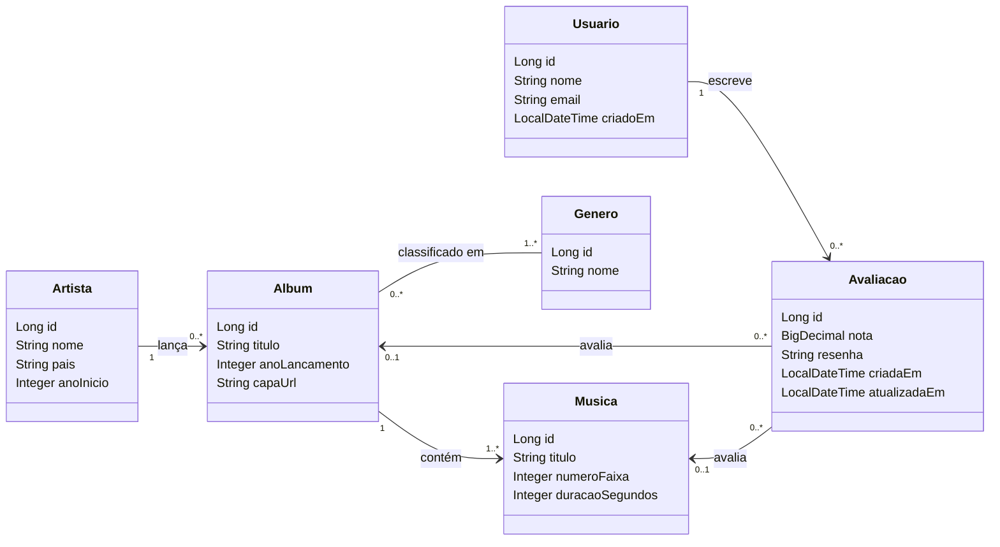

# API de Avaliação Musical

API REST para avaliar álbuns e músicas. O usuário registra o que ouviu, dá uma nota e escreve uma resenha. A ideia segue o modelo do Letterboxd, aplicado à música.

Projeto final da disciplina de API REST. O enunciado está em [docs/enunciado-projeto-final.md](docs/enunciado-projeto-final.md). O catálogo de cartas-desafio está em [docs/cartas-desafio.md](docs/cartas-desafio.md).

## Tema

**Entretenimento e Cultura.**

## Integrantes

| Integrante | Papel |
| --- | --- |
| Gabriel de Oliveira Rodrigues | Modelagem, implementação, testes e documentação |

## Problema

Quem ouve música não tem um lugar central para registrar e comparar opiniões sobre álbuns e faixas. As plataformas de streaming tocam a música, mas guardam pouca opinião do ouvinte. A avaliação de um álbum inteiro também é diferente da avaliação de cada faixa.

A API resolve isso com estas funções:

- registrar artistas, álbuns, músicas e gêneros;
- permitir que cada usuário avalie álbuns e músicas com nota e resenha;
- listar e ordenar álbuns e músicas por nota média, ano e gênero;
- consultar o histórico de avaliações de cada usuário.

## Domínio

| Entidade | Descrição |
| --- | --- |
| Artista | Pessoa ou banda que lança álbuns. |
| Álbum | Lançamento de um artista. Tem título, ano, capa e um ou mais gêneros. |
| Música | Faixa de um álbum. Tem título, número da faixa e duração. |
| Gênero | Classificação musical, por exemplo rock, jazz ou MPB. |
| Usuário | Pessoa que avalia álbuns e músicas. |
| Avaliação | Nota e resenha de um usuário sobre um álbum ou sobre uma música. |

### Relacionamentos

| Relacionamento | Cardinalidade | Regra |
| --- | --- | --- |
| Artista → Álbum | 1:N | Um artista tem vários álbuns. Um álbum pertence a um artista. |
| Álbum → Música | 1:N | Um álbum tem várias músicas. Uma música pertence a um álbum. |
| Álbum ↔ Gênero | N:N | Um álbum tem vários gêneros. Um gênero classifica vários álbuns. |
| Usuário → Avaliação | 1:N | Um usuário faz várias avaliações. |
| Álbum → Avaliação | 1:N | Um álbum recebe várias avaliações. |
| Música → Avaliação | 1:N | Uma música recebe várias avaliações. |

### Regras de negócio

- A nota vai de 0,5 a 5, em passos de 0,5.
- Cada avaliação aponta para um álbum **ou** para uma música. A avaliação nunca aponta para os dois ao mesmo tempo.
- Cada usuário avalia o mesmo álbum uma vez só. A mesma regra vale para a música.
- O número da faixa é único dentro do álbum.
- O e-mail do usuário é único.

## Diagrama UML inicial



> **Nota:** este é o modelo inicial da entrega E1. O modelo pode mudar na API base e na carta-desafio. Cada mudança fica registrada neste README.
>
> **E2:** o modelo foi implementado como está no diagrama. A única adição é o campo `notaMedia` nas respostas de álbum e música, que é calculado a partir das avaliações e não fica salvo no banco. Por isso a ordenação por nota média ainda não está disponível no `sort`; a listagem de avaliações pode ser ordenada por `nota`.

## Cronograma de entregas

| Entrega | Data | Conteúdo | Situação |
| --- | --- | --- | --- |
| E1 | 19/11 | Repositório, tema, integrantes, problema, domínio e UML inicial | Entregue |
| E2 | 26/11 | API base com CRUD e requisitos obrigatórios | Entregue |
| E3 | 03/12 | Carta-desafio, requisitos extras, slides e evidências | Pendente |

## Tecnologias

- Java 17
- Spring Boot 4.1.1 (Web MVC, Data JPA, Validation)
- H2 Database em arquivo (`./data/musica`)
- Maven

## Como executar

Pré-requisito: JDK 17 ou superior instalado.

**Pelo IntelliJ:** abra a pasta do projeto, espere o Maven baixar as dependências e rode a classe `MusicaApplication`.

**Pelo terminal (Linux / macOS):**

```bash
./mvnw spring-boot:run
```

A API sobe em `http://localhost:8080`. Na primeira execução o banco é criado em `./data/` e um seed cadastra gêneros, artistas, álbuns, músicas, usuários e avaliações de exemplo. Para voltar ao estado inicial, é só apagar a pasta `data/`.

Para rodar os testes: pelo IntelliJ, rode a classe `MusicaApplicationTests`; pelo terminal, `./mvnw test`.

### Variáveis de ambiente

Todas são opcionais. Sem elas, a API usa o H2 local.

| Variável | Padrão | Descrição |
| --- | --- | --- |
| `DB_URL` | `jdbc:h2:file:./data/musica` | URL JDBC do banco |
| `DB_USER` | `sa` | Usuário do banco |
| `DB_PASSWORD` | (vazio) | Senha do banco |

### Console do H2

Disponível em `http://localhost:8080/h2-console` com a JDBC URL `jdbc:h2:file:./data/musica`, usuário `sa` e senha vazia.

## Estrutura do projeto

O código segue a arquitetura em camadas: o controller recebe a requisição, o service aplica as regras de negócio e o repository conversa com o banco.

```text
src/main/java/com/example/musica
├── config        # SeedConfig com os dados iniciais
├── controller    # endpoints REST
├── dto           # records de entrada (RequestDto) e saída (ResponseDto)
├── exception     # exceções e ApiExceptionHandler
├── mapper        # conversão entidade -> DTO
├── model         # entidades JPA
├── repository    # interfaces Spring Data JPA
└── service       # regras de negócio
```

## Endpoints

Todas as entidades têm CRUD completo:

| Método | Rota | Descrição | Sucesso |
| --- | --- | --- | --- |
| GET | `/{recurso}` | Lista com paginação, filtros e ordenação | 200 |
| GET | `/{recurso}/{id}` | Busca por id | 200 |
| POST | `/{recurso}` | Cria | 201 |
| PUT | `/{recurso}/{id}` | Atualiza | 200 |
| DELETE | `/{recurso}/{id}` | Remove | 204 |

Recursos: `/artistas`, `/generos`, `/albuns`, `/musicas`, `/usuarios` e `/avaliacoes`.

A collection do Postman com todas as requisições está em [postman/collections/apirest-2026](postman/collections/apirest-2026), no formato v3 (YAML). Para usar, abra a pasta raiz do repositório no Postman (Local Mode). Cada pasta da collection é um diretório e cada requisição é um arquivo `.request.yaml`.

## DTOs

Cada entidade tem um DTO de entrada (`RequestDto`) e um de saída (`ResponseDto`). As entidades JPA nunca são expostas diretamente.

| Entidade | Entrada | Saída |
| --- | --- | --- |
| Artista | `nome`, `pais`, `anoInicio` | `id`, `nome`, `pais`, `anoInicio` |
| Gênero | `nome` | `id`, `nome` |
| Álbum | `titulo`, `anoLancamento`, `capaUrl`, `artistaId`, `generoIds` | `id`, `titulo`, `anoLancamento`, `capaUrl`, `artista` (objeto), `generos` (lista), `notaMedia` |
| Música | `titulo`, `numeroFaixa`, `duracaoSegundos`, `albumId` | `id`, `titulo`, `numeroFaixa`, `duracaoSegundos`, `albumId`, `albumTitulo`, `notaMedia` |
| Usuário | `nome`, `email` | `id`, `nome`, `email`, `criadoEm` |
| Avaliação | `usuarioId`, `albumId` **ou** `musicaId`, `nota`, `resenha` | `id`, `usuarioId`, `usuarioNome`, `albumId`/`albumTitulo` ou `musicaId`/`musicaTitulo`, `nota`, `resenha`, `criadaEm`, `atualizadaEm` |

Os campos `id`, `criadoEm`, `criadaEm`, `atualizadaEm` e `notaMedia` são gerados pela API. A `notaMedia` é a média das avaliações do álbum ou da música (fica `null` quando ainda não há avaliação).

Exemplo de entrada (`POST /albuns`):

```json
{
  "titulo": "Racional Vol. 1",
  "anoLancamento": 1975,
  "artistaId": 5,
  "generoIds": [3, 6]
}
```

Exemplo de saída:

```json
{
  "id": 5,
  "titulo": "Racional Vol. 1",
  "anoLancamento": 1975,
  "capaUrl": null,
  "artista": { "id": 5, "nome": "Tim Maia", "pais": "Brasil", "anoInicio": 1959 },
  "generos": [ { "id": 3, "nome": "MPB" }, { "id": 6, "nome": "Soul" } ],
  "notaMedia": null
}
```

## Validação e tratamento de erros

A validação dos campos usa Bean Validation (`@NotBlank`, `@NotNull`, `@Size`, `@Email`, `@Min`, `@Max`, `@Positive`, `@DecimalMin`, `@DecimalMax`) nos DTOs de entrada. As regras de negócio ficam nos services.

Os erros são tratados no `ApiExceptionHandler` e sempre retornam no formato Problem Details (RFC 9457):

| Código | Quando acontece |
| --- | --- |
| 400 | Campo obrigatório vazio, formato inválido, nota fora de 0,5 a 5, JSON mal formatado, id inválido na rota, campo de `sort` inexistente |
| 404 | Recurso não existe (inclusive ids informados no corpo, como `artistaId` ou `generoIds`) |
| 409 | E-mail repetido, gênero repetido, número de faixa repetido no álbum, usuário avaliando o mesmo álbum/música duas vezes, remoção de registro que tem dependentes |
| 422 | Avaliação com álbum e música ao mesmo tempo (ou sem nenhum dos dois), nota fora do passo de 0,5 |
| 500 | Erro inesperado (a mensagem não expõe detalhes internos) |

Regras de remoção: não dá para remover artista com álbuns, álbum com músicas ou avaliações, música com avaliações, usuário com avaliações e gênero usado por álbuns. Nesses casos a API retorna 409.

Exemplo de 400 (`POST /usuarios` com `{"nome":"","email":"nao-e-email"}`):

```json
{
  "title": "Erro de validação",
  "status": 400,
  "detail": "Um ou mais campos são inválidos",
  "instance": "/usuarios",
  "errors": {
    "nome": "O nome é obrigatório",
    "email": "O e-mail é inválido"
  }
}
```

Exemplo de 404:

```json
{
  "title": "Recurso não encontrado",
  "status": 404,
  "detail": "Álbum com id 999 não existe",
  "instance": "/albuns/999"
}
```

Exemplo de 409:

```json
{
  "title": "Conflito",
  "status": 409,
  "detail": "Este usuário já avaliou este álbum",
  "instance": "/avaliacoes"
}
```

Exemplo de 422:

```json
{
  "title": "Regra de negócio violada",
  "status": 422,
  "detail": "A avaliação deve ser de um álbum ou de uma música, nunca dos dois",
  "instance": "/avaliacoes"
}
```

## Paginação, filtros e ordenação

Todos os endpoints de listagem aceitam os parâmetros do Spring Data:

| Parâmetro | Descrição | Padrão |
| --- | --- | --- |
| `page` | Número da página, começando em 0 | `0` |
| `size` | Itens por página | `10` |
| `sort` | Campo e direção, ex.: `sort=anoLancamento,desc`. Pode repetir para ordenar por mais de um campo | depende do recurso |

Filtros de cada recurso (todos opcionais e combináveis):

| Recurso | Filtros | Ordenação padrão |
| --- | --- | --- |
| `/artistas` | `nome`, `pais` (contém, sem diferenciar maiúsculas) | `nome` |
| `/generos` | `nome` (contém) | `nome` |
| `/albuns` | `titulo` (contém), `ano`, `artistaId`, `generoId` | `titulo` |
| `/musicas` | `titulo` (contém), `albumId` | `numeroFaixa` |
| `/usuarios` | `nome`, `email` (contém) | `nome` |
| `/avaliacoes` | `usuarioId`, `albumId`, `musicaId`, `notaMinima` | `criadaEm` |

O filtro `usuarioId` em `/avaliacoes` mostra o histórico de avaliações de um usuário.

Exemplo: `GET /albuns?page=0&size=2&sort=anoLancamento,desc`

```json
{
  "content": [
    {
      "id": 2,
      "titulo": "In Rainbows",
      "anoLancamento": 2007,
      "capaUrl": null,
      "artista": { "id": 1, "nome": "Radiohead", "pais": "Reino Unido", "anoInicio": 1985 },
      "generos": [ { "id": 2, "nome": "Alternativo" }, { "id": 1, "nome": "Rock" } ],
      "notaMedia": 4.0
    },
    {
      "id": 1,
      "titulo": "OK Computer",
      "anoLancamento": 1997,
      "capaUrl": null,
      "artista": { "id": 1, "nome": "Radiohead", "pais": "Reino Unido", "anoInicio": 1985 },
      "generos": [ { "id": 2, "nome": "Alternativo" }, { "id": 1, "nome": "Rock" } ],
      "notaMedia": 4.75
    }
  ],
  "page": { "size": 2, "number": 0, "totalElements": 4, "totalPages": 2 }
}
```

Outros exemplos:

- `GET /albuns?artistaId=1&generoId=2` – álbuns do Radiohead no gênero Alternativo;
- `GET /musicas?albumId=1&sort=numeroFaixa` – faixas do OK Computer em ordem;
- `GET /avaliacoes?notaMinima=4.5&sort=nota,desc` – avaliações com nota 4,5 ou mais, da maior para a menor;
- `GET /artistas?pais=brasil` – artistas do Brasil.

## Evidências

Prints da API rodando localmente, tirados no Postman e no console do H2. A collection usada está em [postman/collections/apirest-2026](postman/collections/apirest-2026).

| Evidência | O que mostra |
| --- | --- |
| [01-listar-paginacao-ordenacao](evidencias/01-listar-paginacao-ordenacao.png) | `GET /albuns?page=0&size=2&sort=anoLancamento,desc` (200) |
| [02-filtro-artista-genero](evidencias/02-filtro-artista-genero.png) | `GET /albuns?artistaId=1&generoId=2` (200) |
| [03-historico-usuario](evidencias/03-historico-usuario.png) | `GET /avaliacoes?usuarioId=1` (200) |
| [04-criar-album](evidencias/04-criar-album.png) | `POST /albuns` com artista e gêneros (201) |
| [05-buscar-album](evidencias/05-buscar-album.png) | `GET /albuns/5` com nota média (200) |
| [06-atualizar-avaliacao](evidencias/06-atualizar-avaliacao.png) | `PUT /avaliacoes/10` (200) |
| [07-remover-artista](evidencias/07-remover-artista.png) | `DELETE /artistas/5` (204) |
| [08-validacao-400](evidencias/08-validacao-400.png) | Campos inválidos no `POST /usuarios` (400) |
| [09-nao-encontrado-404](evidencias/09-nao-encontrado-404.png) | `GET /albuns/999` (404) |
| [10-conflito-409](evidencias/10-conflito-409.png) | Usuário avaliando o mesmo álbum duas vezes (409) |
| [11-regra-negocio-422](evidencias/11-regra-negocio-422.png) | Avaliação de álbum e música ao mesmo tempo (422) |
| [12-banco-h2](evidencias/12-banco-h2.png) | Dados salvos no H2, com álbuns, artistas e gêneros |
| [13-run-collection](evidencias/13-run-collection.png) | Todas as requisições da collection rodadas em sequência |
