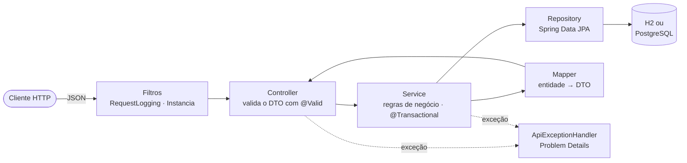
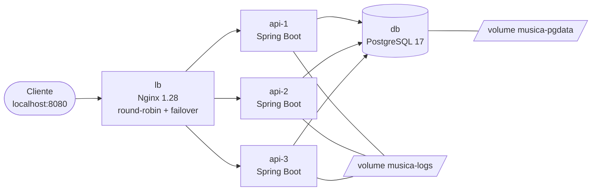

# Arquitetura

## Camadas

O código segue a arquitetura em camadas: o **controller** recebe a requisição HTTP, o **service** aplica as regras de negócio e o **repository** conversa com o banco. As entidades JPA nunca saem do service: o controller recebe e devolve **DTOs** (records).



| Pacote | Responsabilidade |
| --- | --- |
| `controller` | Endpoints REST. Recebem DTOs de entrada validados com `@Valid` e devolvem DTOs de saída. Documentados com anotações OpenAPI. |
| `service` | Regras de negócio, transações e checagens de duplicidade e dependências antes de gravar ou remover. |
| `repository` | Interfaces Spring Data JPA, com consultas JPQL para os filtros combinados e a média das notas. |
| `model` | Entidades JPA (`Artista`, `Album`, `Musica`, `Genero`, `Usuario`, `Avaliacao`). |
| `dto` | Records de entrada (`*RequestDto`, com Bean Validation) e de saída (`*ResponseDto`). |
| `mapper` | Conversão de entidade para DTO. |
| `exception` | Exceções de domínio e o `ApiExceptionHandler`, que transforma tudo em Problem Details (RFC 9457). |
| `config` | `SeedConfig` (dados de exemplo), `OpenApiConfig` (Swagger), `CorsConfig` (origens liberadas), `RequestLoggingFilter` (log das requisições) e `InstanciaFilter` (header `X-Instancia`). |

```text
src/main/java/com/example/musica
├── config
├── controller
├── dto
├── exception
├── mapper
├── model
├── repository
└── service
```

!!! tip "Por que `spring.jpa.open-in-view=false`?"
    Os DTOs são montados **dentro** da transação do service. Assim, nenhum lazy loading escondido acontece no controller, e as consultas ao banco ficam previsíveis.

## Infraestrutura com Docker

Com `docker compose up --build`, o projeto sobe com PostgreSQL, três instâncias da API e um Nginx na frente:



| Serviço | Imagem | Porta no host | Papel |
| --- | --- | --- | --- |
| `lb` | `nginx:1.28-alpine` | 8080 | Único ponto de entrada; distribui as requisições e tira do rodízio as instâncias que falham. |
| `api` (×3) | construída pelo `Dockerfile` | nenhuma | A API com o profile `postgres`. Não guarda estado em memória, então qualquer instância atende qualquer requisição. |
| `db` | `postgres:17-alpine` | 5432 | Banco compartilhado pelas instâncias, com os dados num volume persistente. |

A ordem de subida é garantida por health checks: o `db` precisa estar pronto (`pg_isready`) para a `api` subir, e as réplicas da `api` precisam estar `healthy` (`/actuator/health`) para o `lb` subir.

Os detalhes estão em [Docker/Compose](extras/docker.md) e [Load balancer](extras/load-balancer.md).
