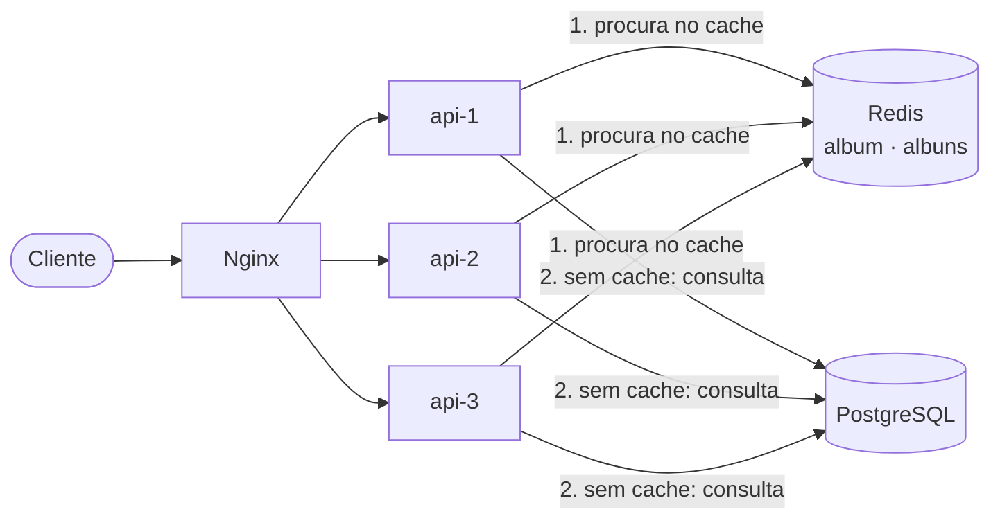

# Carta-desafio: cache de consultas frequentes

!!! abstract "Carta 5 · Cache de consultas frequentes · 40%"
    Issue [#21](https://github.com/gabrieldorodrigues/apirest-2026/issues/21) · PR [#22](https://github.com/gabrieldorodrigues/apirest-2026/pull/22)

## História de usuário

Como ouvinte que navega pelo catálogo, quero que a consulta de álbuns responda rápido, porque é a tela que mais abro e os álbuns mudam pouco. A nota média que aparece precisa estar sempre certa: quando alguém avalia um álbum, a nova média deve aparecer na hora, em qualquer instância da API.

## O que fica em cache

| Cache | Endpoint | Chave | Exemplo de chave no Redis |
| --- | --- | --- | --- |
| `album` | `GET /albuns/{id}` | Id do álbum | `album::1` |
| `albuns` | `GET /albuns` | Filtros, página, tamanho e ordenação | `albuns::titulo=null;ano=null;artistaId=1;generoId=null;page=0;size=2;sort=titulo: ASC` |

Os álbuns são a leitura mais frequente do catálogo e a mais cara. Cada álbum calcula a `notaMedia` com uma consulta ao banco, então uma página com 10 álbuns faz mais de 10 consultas. Com o cache, a mesma página repetida não faz nenhuma.

O cache guarda a resposta pronta (`AlbumResponseDto`), com o artista, os gêneros e a `notaMedia` já calculados.

## TTL

Cada entrada expira em **10 minutos** (`spring.cache.redis.time-to-live`). Para trocar, defina `CACHE_TTL` no `.env`, por exemplo `CACHE_TTL=30s`.

O TTL é uma rede de segurança. A nota média fica certa pela invalidação, e o TTL só limita quanto tempo um dado pode durar se alguma mudança escapar da invalidação, como uma alteração feita direto no banco.

## Invalidação

| Operação | O que é apagado do cache | Por quê |
| --- | --- | --- |
| Criar álbum | Todas as listagens | O álbum novo pode entrar em qualquer página |
| Editar ou remover álbum | O álbum e todas as listagens | O álbum mudou ou saiu |
| Criar, editar ou remover avaliação de álbum | O álbum avaliado e todas as listagens | A `notaMedia` mudou |
| Editar avaliação que troca de álbum, ou de álbum para música | O álbum antigo também | A média do álbum antigo também mudou |
| Editar artista ou gênero | Todos os álbuns e todas as listagens | O nome vai dentro da resposta de cada álbum |
| Avaliação de música, usuário | Nada | Não aparecem na resposta do álbum |

As listagens são apagadas inteiras porque não dá para saber quais páginas mostram o álbum alterado. As escritas são raras perto das leituras, então isso custa pouco.

### Depois do commit

O `RedisCacheManager` é `transactionAware`: o cache só é apagado depois do commit da transação. Se fosse antes, outra réplica poderia ler o banco ainda sem a mudança e guardar de novo o valor antigo, que ficaria no cache até o TTL vencer.

## Por que Redis

A API roda com 3 réplicas atrás do Nginx (veja [Load balancer](extras/load-balancer.md)). Com um cache em memória em cada réplica, uma avaliação atendida pela `api-1` apagaria só o cache da `api-1`. A `api-2` e a `api-3` continuariam mostrando a média antiga.

Com o Redis, as 3 réplicas usam o mesmo cache. A invalidação feita por uma vale para todas.



| Situação | Tipo de cache |
| --- | --- |
| `docker compose up` | Redis (`CACHE_TYPE=redis`), compartilhado pelas réplicas |
| Execução local com H2, sem Redis | Em memória, na única instância. Sem TTL, com a mesma invalidação |
| Testes que rodam numa transação desfeita | Desligado, porque o rollback não desfaz o cache |

## Dados sensíveis e erros

- **Fora do cache:** usuários (têm e-mail) e avaliações. O teste `soAlbunsTemCache` confere que só existem os caches `album` e `albuns`.
- **404 não fica no cache:** um álbum inexistente lança a exceção antes de guardar a resposta.
- **Redis fora do ar:** o `CacheConfig` registra um aviso no log e a consulta segue para o banco, sem 500. O tempo limite de conexão é de 1 s.
- **Fora do health check:** o Redis não entra no `/actuator/health`. Ele é só cache, e a API continua atendendo sem ele. Se entrasse, o Nginx tiraria as réplicas do ar quando o Redis caísse.

## Ganho de desempenho

O teste conta os comandos SQL com as estatísticas do Hibernate:

| Requisição | Comandos SQL |
| --- | --- |
| Primeiro `GET /albuns/1` | Vai ao banco: álbum, artista, gêneros e nota média |
| Segundo `GET /albuns/1` | **0** |
| `GET /albuns?size=2` repetido | **0** |
| `GET /usuarios/1` repetido | Vai ao banco nas duas vezes (sem cache) |

As métricas do cache ficam no Actuator:

```bash
curl "http://localhost:8080/actuator/metrics/cache.gets?tag=cache:album&tag=result:hit"
curl "http://localhost:8080/actuator/metrics/cache.gets?tag=cache:album&tag=result:miss"
```

Para comparar o tempo de resposta, meça a mesma requisição antes e depois de o cache existir:

```bash
docker exec musica-redis redis-cli FLUSHALL
curl -s -o /dev/null -w "sem cache: %{time_total}s\n" "http://localhost:8080/albuns?size=10"
curl -s -o /dev/null -w "com cache: %{time_total}s\n" "http://localhost:8080/albuns?size=10"
```

## Implementação

| Arquivo | Papel |
| --- | --- |
| `config/CacheConfig.java` | `@EnableCaching`, nomes dos caches, invalidação depois do commit e tratamento de falha do Redis |
| `service/AlbumService.java` | `@Cacheable` na busca e na listagem; `@CacheEvict` em criar, editar e remover; `invalidarCache` para o `AvaliacaoService` |
| `service/AvaliacaoService.java` | Invalida o álbum quando uma avaliação é criada, editada ou removida |
| `service/ArtistaService.java` e `service/GeneroService.java` | Invalidam os álbuns quando o nome muda |
| `dto/AlbumResponseDto.java`, `ArtistaResponseDto.java` e `GeneroResponseDto.java` | `Serializable`, para o Redis guardar a resposta |
| `application.properties` | Tipo de cache, nomes, TTL, endereço do Redis e estatísticas |
| `docker-compose.yml` | Serviço `redis` com healthcheck; a API só sobe depois dele |

Nenhuma entidade nova foi criada. O cache fica nos services que já existiam.

## Como testar

1. Suba tudo: `docker compose up --build`.
2. Rode `GET /albuns/1` duas vezes.
3. Confira a chave e o TTL no Redis:

    ```bash
    docker exec musica-redis redis-cli KEYS '*'
    docker exec musica-redis redis-cli TTL album::1
    ```

4. Crie uma avaliação do álbum 1 com `POST /avaliacoes` (`{"usuarioId": 3, "albumId": 1, "nota": 2.0}`).
5. Rode `GET /albuns/1` algumas vezes. A `notaMedia` muda de 4,75 para 3,83 em todas as respostas, qualquer que seja o header `X-Instancia`.
6. Edite o artista 1 com `PUT /artistas/1` e rode `GET /albuns/1`. O nome novo aparece.
7. Confira as métricas de hit e miss com os comandos da seção anterior.

## Testes

| Classe | Testes | O que cobre |
| --- | --- | --- |
| `CacheAlbunsTest` | 7 | Com cache em memória: segunda busca e listagem repetida sem SQL; outra página vai ao banco; criar, editar e remover avaliação atualizam a `notaMedia`; avaliação que troca de álbum invalida o antigo; editar artista invalida os álbuns; 404 fora do cache; só álbuns têm cache |
| `CacheRedisTest` | 4 | Com Redis 8 do Testcontainers: chave `album::1` e TTL; listagem guardada e lida de volta do Redis; avaliação apaga as chaves; métricas de hit. **Precisa do Docker**; sem Docker, os 4 testes são pulados |
