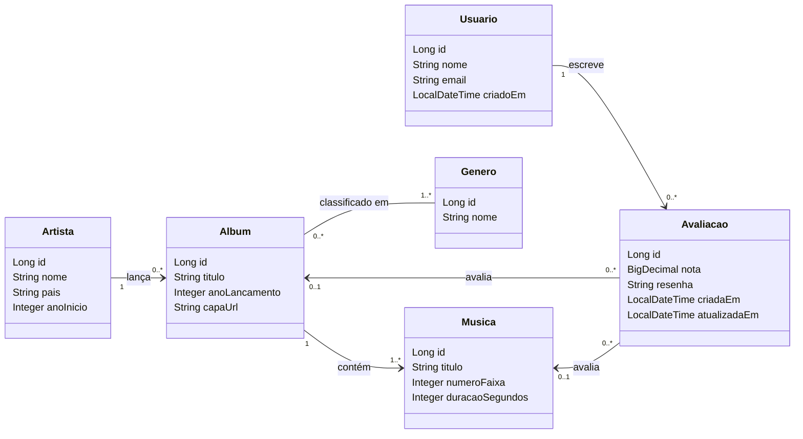
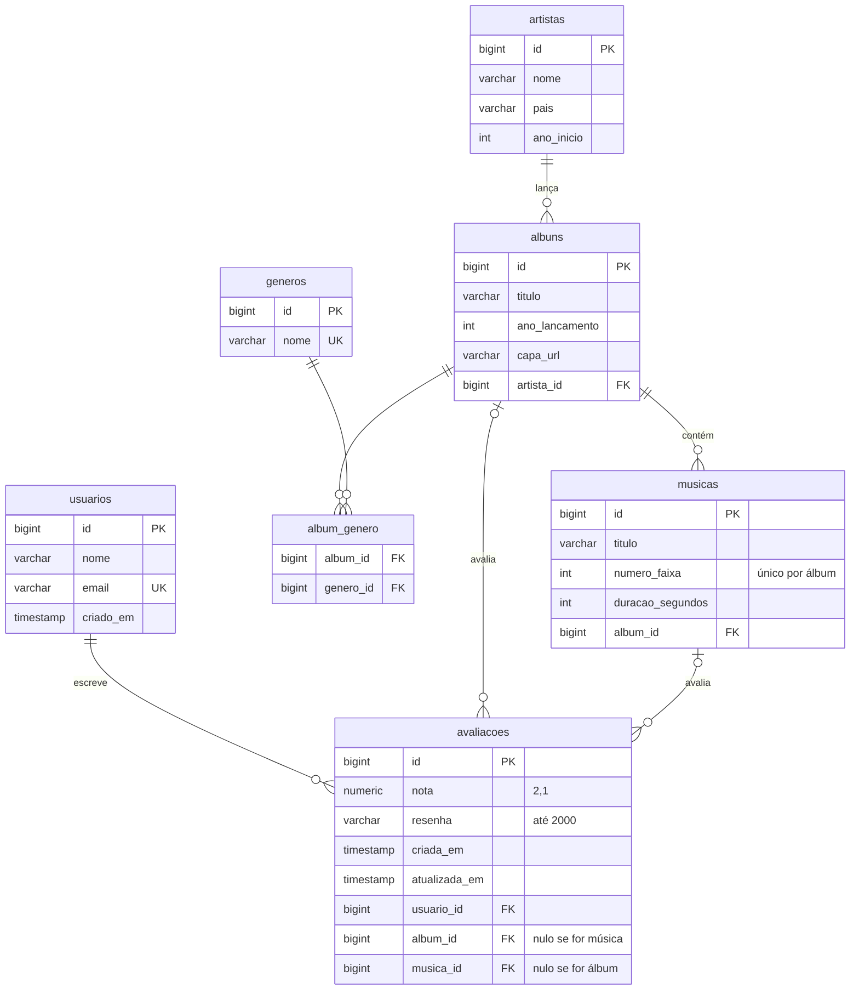

# Domínio

O domínio gira em torno da **avaliação**: um usuário dá uma nota (e opcionalmente uma resenha) para um álbum **ou** para uma música. O resto do modelo é o catálogo que está sendo avaliado.

## Entidades

| Entidade | Descrição | Campos principais |
| --- | --- | --- |
| **Artista** | Pessoa ou banda que lança álbuns. | `nome`, `pais`, `anoInicio` |
| **Álbum** | Lançamento de um artista, com um ou mais gêneros. | `titulo`, `anoLancamento`, `capaUrl` |
| **Música** | Faixa de um álbum. | `titulo`, `numeroFaixa`, `duracaoSegundos` |
| **Gênero** | Classificação musical, como rock, jazz ou MPB. | `nome` |
| **Usuário** | Pessoa que avalia álbuns e músicas. | `nome`, `email`, `criadoEm` |
| **Avaliação** | Nota e resenha de um usuário sobre um álbum ou uma música. | `nota`, `resenha`, `criadaEm`, `atualizadaEm` |

!!! info "Nota média"
    Álbuns e músicas têm uma `notaMedia` nas respostas da API. Ela **não fica salva no banco**: é calculada (`avg`) a partir das avaliações a cada consulta, então está sempre atualizada. Fica `null` enquanto não houver avaliação.

## Relacionamentos

| Relacionamento | Cardinalidade | Regra |
| --- | --- | --- |
| Artista → Álbum | 1:N | Um artista tem vários álbuns. Um álbum pertence a um artista. |
| Álbum → Música | 1:N | Um álbum tem várias músicas. Uma música pertence a um álbum. |
| Álbum ↔ Gênero | N:N | Um álbum tem vários gêneros. Um gênero classifica vários álbuns. |
| Usuário → Avaliação | 1:N | Um usuário faz várias avaliações. |
| Álbum → Avaliação | 1:N | Um álbum recebe várias avaliações. |
| Música → Avaliação | 1:N | Uma música recebe várias avaliações. |

## Diagrama de classes

## Modelo do banco

As tabelas são criadas pelo Hibernate a partir das entidades JPA, com os nomes em `snake_case`. O mesmo modelo é usado no H2 e no PostgreSQL.

## Regras de negócio

| Regra | Onde é garantida | Erro |
| --- | --- | --- |
| A nota vai de **0,5 a 5**. | Bean Validation no DTO (`@DecimalMin`, `@DecimalMax`) | 400 |
| A nota anda em **passos de 0,5** (3,0 · 3,5 · 4,0...). | `AvaliacaoService` | 422 |
| Cada avaliação aponta para um álbum **ou** para uma música, nunca os dois (e nunca nenhum). | `AvaliacaoService` | 422 |
| Cada usuário avalia o **mesmo álbum uma vez só**. A mesma regra vale para a música. | `AvaliacaoService` | 409 |
| O **número da faixa** é único dentro do álbum. | `MusicaService` + constraint única no banco | 409 |
| O **e-mail** do usuário é único, sem diferenciar maiúsculas (é salvo em minúsculo). | `UsuarioService` + constraint única no banco | 409 |
| O **nome do gênero** é único, sem diferenciar maiúsculas. | `GeneroService` + constraint única no banco | 409 |
| Não dá para remover artista com álbuns, álbum com músicas ou avaliações, música com avaliações, usuário com avaliações nem gênero usado por álbuns. | Services | 409 |

Os detalhes de cada erro estão em [Validação e erros](api/erros.md).

## Dados de exemplo

Na primeira execução, o `SeedConfig` cadastra um catálogo para testar a API sem precisar criar nada:

| Tipo | Registros |
| --- | --- |
| Gêneros | Rock, Alternativo, MPB, Jazz, Tropicália |
| Artistas | Radiohead, Caetano Veloso, Miles Davis, Os Mutantes (sem álbuns) |
| Álbuns | OK Computer (1997), In Rainbows (2007), Caetano Veloso (1968), Kind of Blue (1959) |
| Músicas | 9 faixas, como Paranoid Android, Karma Police, Reckoner, Tropicália e So What |
| Usuários | Gabriel, Ana e João |
| Avaliações | 9 (5 de álbuns e 4 de músicas) |

O seed só roda com o banco vazio. Com várias instâncias da API subindo juntas, um lock no PostgreSQL garante que ele rode uma vez só (veja [Load balancer](extras/load-balancer.md#seed-seguro)).
