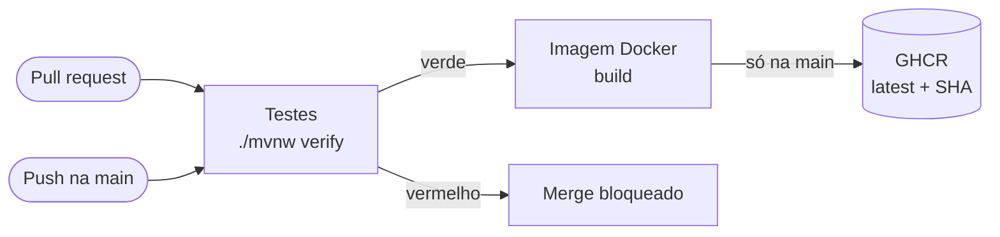

# CI/CD

!!! abstract "Requisito extra · 5%"
    Issue [#16](https://github.com/gabrieldorodrigues/apirest-2026/issues/16) · PR [#17](https://github.com/gabrieldorodrigues/apirest-2026/pull/17)

O repositório tem dois workflows no **GitHub Actions**:

| Workflow | Arquivo | Quando roda | O que faz |
| --- | --- | --- | --- |
| **CI** | `.github/workflows/ci.yml` | Todo pull request e todo push na `main` | Compila, roda os testes e gera a imagem Docker. Na `main`, publica a imagem no GitHub Container Registry |
| **Documentação** | `.github/workflows/docs.yml` | Mudança em `docs/`, `evidencias/`, `mkdocs.yml` ou no código da API | Gera a especificação OpenAPI e o site com MkDocs e a [Swagger UI](swagger.md#swagger-ui-no-github-pages). Na `main`, publica no GitHub Pages |



## CI: testes

O job **Testes** roda `./mvnw -B verify` com Java 17 (Temurin) e cache das dependências do Maven.

- Roda **todos os testes**, inclusive o `PostgresIntegracaoTest`. O runner do GitHub tem Docker, então o Testcontainers cria um PostgreSQL 17 de verdade e os testes não são pulados;
- O **resumo da execução** mostra uma tabela com os testes, as falhas e os pulados de cada classe;
- O relatório do Surefire fica salvo como artefato `relatorio-testes`, mesmo quando um teste falha.

## CI: imagem Docker

O job **Imagem Docker** só começa depois que os testes passam. Ele usa o mesmo `Dockerfile` do [Docker/Compose](docker.md).

| Evento | O que acontece com a imagem |
| --- | --- |
| Pull request | Só gera a imagem, para garantir que o `Dockerfile` continua funcionando |
| Push na `main` | Gera e publica em `ghcr.io/gabrieldorodrigues/apirest-2026` |

Cada imagem publicada recebe duas tags:

| Tag | Para que serve |
| --- | --- |
| `latest` | Sempre a versão atual da `main` |
| SHA do commit | Uma versão fixa, para voltar a um commit específico |

O login no registry usa o `GITHUB_TOKEN` da própria execução, sem conta nem segredo externo. O cache das camadas fica no GitHub Actions (`type=gha`), então um build sem mudança no `pom.xml` não baixa as dependências de novo.

## CD: rodar a versão da main

A imagem publicada roda no mesmo `docker-compose.yml`, com o load balancer e o PostgreSQL. Defina `API_IMAGE` (no `.env` ou no terminal), baixe a imagem e suba sem compilar:

```bash
API_IMAGE=ghcr.io/gabrieldorodrigues/apirest-2026 docker compose pull api
API_IMAGE=ghcr.io/gabrieldorodrigues/apirest-2026 docker compose up --no-build
```

Sem `API_IMAGE`, o compose continua gerando a imagem a partir do código local com `docker compose up --build`.

## Proteção da main

A `main` exige o check **Testes** verde para aceitar o merge de um pull request. Um teste quebrado deixa o check vermelho e bloqueia o merge.

## Como testar

1. Abra um pull request e veja o workflow **CI** em **Checks**: o job **Testes** e depois o job **Imagem Docker**.
2. Abra o resumo da execução e confira a tabela com os testes de cada classe, inclusive os 7 do `PostgresIntegracaoTest`.
3. Depois do merge na `main`, veja a imagem em **Packages** no repositório e rode a versão publicada com os comandos acima.
