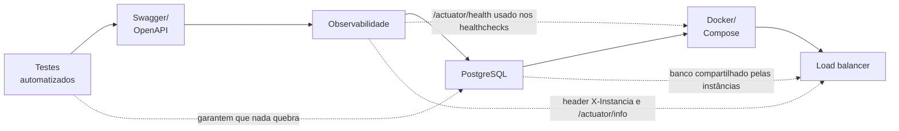

# Requisitos extras

Os requisitos extras valem até **20%** da nota. Cada um foi feito numa issue e num pull request próprios, integrado ao domínio da API, documentado e com evidências.

| Extra | Peso | Issue | PR | Página |
| --- | --- | --- | --- | --- |
| Testes automatizados | 5% | [#5](https://github.com/gabrieldorodrigues/apirest-2026/issues/5) | [#6](https://github.com/gabrieldorodrigues/apirest-2026/pull/6) | [Testes](testes.md) |
| Swagger/OpenAPI | 5% | [#1](https://github.com/gabrieldorodrigues/apirest-2026/issues/1) | [#7](https://github.com/gabrieldorodrigues/apirest-2026/pull/7) | [Swagger](swagger.md) |
| Observabilidade: health check, Actuator, métricas e logs | 5% | [#2](https://github.com/gabrieldorodrigues/apirest-2026/issues/2) | [#8](https://github.com/gabrieldorodrigues/apirest-2026/pull/8) | [Observabilidade](observabilidade.md) |
| SGBD diferente do H2 (PostgreSQL) | 5% | [#3](https://github.com/gabrieldorodrigues/apirest-2026/issues/3) | [#9](https://github.com/gabrieldorodrigues/apirest-2026/pull/9) | [PostgreSQL](postgresql.md) |
| Docker/Compose | 5% | [#4](https://github.com/gabrieldorodrigues/apirest-2026/issues/4) | [#10](https://github.com/gabrieldorodrigues/apirest-2026/pull/10) | [Docker](docker.md) |
| Load balancer/múltiplas instâncias | 10% | [#11](https://github.com/gabrieldorodrigues/apirest-2026/issues/11) | [#12](https://github.com/gabrieldorodrigues/apirest-2026/pull/12) | [Load balancer](load-balancer.md) |
| **Total implementado** | **35%** | | | limite de 20% na nota |

## Como os extras se conectam

Os extras foram feitos em sequência, e cada um aproveita o anterior:

- Os **testes** passaram a rodar também contra o PostgreSQL (Testcontainers), garantindo que a troca de banco não quebrou nada.
- O **health check** da observabilidade é o que o Docker usa para saber se cada container está pronto.
- O **PostgreSQL** é o estado compartilhado que permite rodar várias instâncias atrás do **load balancer**.
