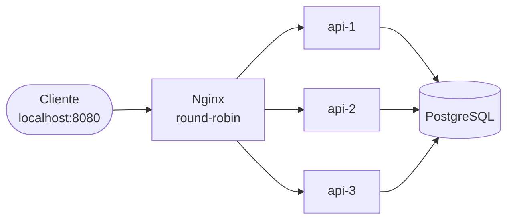

# Load balancer e múltiplas instâncias

!!! abstract "Requisito extra · 10%"
    Issue [#11](https://github.com/gabrieldorodrigues/apirest-2026/issues/11) · PR [#12](https://github.com/gabrieldorodrigues/apirest-2026/pull/12)

Com `docker compose up --build`, a API roda em **3 instâncias** atrás de um **Nginx**, todas usando o mesmo PostgreSQL:



## Distribuição das requisições

O Nginx (`nginx/nginx.conf`) manda cada requisição para a próxima instância (**round-robin**). Só ele fica exposto na porta 8080; as instâncias não publicam porta.

```nginx
resolver 127.0.0.11 valid=5s ipv6=off;

upstream api_musica {
    zone api_musica 64k;
    server api:8080 resolve max_fails=1 fail_timeout=10s;
}

server {
    listen 80;

    location / {
        proxy_pass http://api_musica;
        proxy_connect_timeout 2s;
        proxy_next_upstream error timeout http_502 http_503 http_504;
        proxy_next_upstream_tries 3;
        # ... headers X-Forwarded-*
    }
}
```

- **Descoberta das instâncias:** o nome `api` resolve para o IP de cada réplica no DNS interno do Docker (`127.0.0.11`). Com o `resolve`, o Nginx reconsulta a cada 5 s, então acompanha réplicas que caem, voltam ou trocam de IP;
- **Quantidade:** `API_REPLICAS` no `.env` (padrão 3) ou `docker compose up -d --scale api=5`.

## Failover

Se uma instância não responde, o Nginx tenta a próxima (`proxy_next_upstream`) e a tira do rodízio por 10 s (`max_fails`/`fail_timeout`). Parar uma instância **não derruba a API**. Quando ela volta e fica `healthy`, entra de novo no rodízio.

## Estado compartilhado

A API **não guarda sessão em memória**, então qualquer instância atende qualquer requisição. O estado fica no PostgreSQL:

- uma avaliação criada por uma instância aparece nas outras na mesma hora;
- as regras de negócio (avaliação repetida, faixa repetida, e-mail repetido) continuam valendo, porque são checadas no banco.

## Seed seguro

As três instâncias sobem juntas com o banco vazio, e cada uma veria "não há dados" e gravaria o seed. Para evitar dados duplicados, o `SeedConfig` roda numa transação com um **lock do PostgreSQL**:

```java
return args -> new TransactionTemplate(transactionManager).executeWithoutResult(status -> {
    travarSeedNoPostgres(jdbcTemplate);   // select pg_advisory_xact_lock(...)
    if (artistaRepository.count() > 0) {
        return;
    }
    // grava os dados de exemplo
});
```

A primeira instância pega o lock e grava. As outras esperam, e quando o lock é liberado (no commit) encontram o banco já populado. No H2, que roda numa instância só, o lock não é usado.

## Identificação da instância

O `InstanciaFilter` coloca em toda resposta o header **`X-Instancia`** com o hostname do container que atendeu. O mesmo id aparece em `GET /actuator/info`:

```json
"instancia": { "id": "8321d479f2ae", "iniciadaEm": "2026-11-26T03:39:13" }
```

Cada instância também grava o próprio log (`logs/musica-<hostname>.log`), e `docker compose logs api` mostra os logs com o prefixo `api-1`, `api-2` e `api-3`.

## Como testar

=== "Balanceamento"

    ```powershell
    1..6 | % { (curl.exe -s -D - -o NUL http://localhost:8080/albuns | Select-String "X-Instancia").Line }
    ```

    ```text
    X-Instancia: cfdd9ec29219
    X-Instancia: 27b2af1df075
    X-Instancia: 8321d479f2ae
    X-Instancia: cfdd9ec29219
    X-Instancia: 27b2af1df075
    X-Instancia: 8321d479f2ae
    ```

=== "Failover"

    ```powershell
    docker stop apirest-2026-api-2
    1..6 | % { $h = curl.exe -s -D - -o NUL http://localhost:8080/albuns; "$(($h | Select-String '^HTTP').Line.Trim())  $(($h | Select-String 'X-Instancia').Line)" }
    docker start apirest-2026-api-2
    ```

    ```text
    HTTP/1.1 200  X-Instancia: cfdd9ec29219
    HTTP/1.1 200  X-Instancia: 8321d479f2ae
    HTTP/1.1 200  X-Instancia: cfdd9ec29219
    ...
    ```

=== "Bash"

    ```bash
    for i in 1 2 3 4 5 6; do curl -s -D - -o /dev/null http://localhost:8080/albuns | grep X-Instancia; done
    ```

## O que foi verificado

| Cenário | Resultado |
| --- | --- |
| 3 instâncias subindo juntas com o banco vazio | Seed gravado **uma vez** (4 álbuns, 9 avaliações), sem erro de schema |
| 6 requisições seguidas | `X-Instancia` alternando entre as 3 instâncias |
| `POST` numa instância e `GET` nas outras | Todas enxergam a avaliação |
| `docker stop` numa instância | Todas as requisições com 200, atendidas pelas outras 2 |
| `docker start` de novo | A instância volta ao rodízio |

## Evidências

{ .evidencia }

{ .evidencia }

{ .evidencia }
