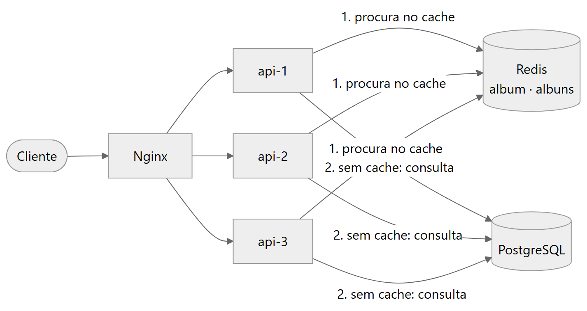

<!-- _class: titulo -->
<!-- _paginate: false -->

# API de Avaliação Musical

Uma API REST para avaliar álbuns e músicas, no modelo do Letterboxd

**Gabriel de Oliveira Rodrigues**
Backend 2026.2 · Tema: Entretenimento e Cultura

<span class="small">github.com/gabrieldorodrigues/apirest-2026 · gabrieldorodrigues.github.io/apirest-2026</span>

---

## Problema

- O streaming toca a música, mas guarda pouca opinião do ouvinte
- Avaliar um álbum inteiro é diferente de avaliar uma faixa
- Não existe um lugar central para registrar e comparar opiniões

**A API resolve isso com:**

- Catálogo: artistas, álbuns, músicas e gêneros
- Avaliações com **nota de 0,5 a 5** e resenha, de um álbum **ou** de uma música
- **Nota média** calculada para cada álbum e cada música
- Histórico de avaliações por usuário

---

## Stack

| Camada | Tecnologia |
| --- | --- |
| Linguagem e framework | Java 17 · Spring Boot 4.1.1 (Web MVC, Data JPA, Validation) |
| Banco | H2 em arquivo (padrão) · PostgreSQL 17 (profile `postgres`) |
| Documentação da API | springdoc-openapi 3.1.1 (Swagger UI e OpenAPI 3) |
| Observabilidade | Spring Boot Actuator · Micrometer |
| Testes | JUnit 5 · MockMvc · Testcontainers |
| Infraestrutura | Docker Compose · Nginx (load balancer) · 3 réplicas |
| Cache | Spring Cache · Redis 8 |
| CI/CD e docs | GitHub Actions · GHCR · MkDocs no GitHub Pages |

---

## Domínio: diagrama UML


---

## Relacionamentos e regras de negócio

<div class="cols">
<div>

| Relação | Tipo |
| --- | --- |
| Artista → Álbum | 1:N |
| Álbum → Música | 1:N |
| Álbum ↔ Gênero | **N:N** |
| Usuário → Avaliação | 1:N |
| Álbum → Avaliação | 1:N |
| Música → Avaliação | 1:N |

</div>
<div>

| Regra | Resposta |
| --- | --- |
| Nota fora de 0,5 a 5 | 400 |
| Nota fora do passo de 0,5 | 422 |
| Álbum **e** música (ou nenhum) | 422 |
| Usuário avalia o mesmo item 2 vezes | 409 |
| Faixa repetida no álbum | 409 |
| E-mail repetido | 409 |
| Remover registro com dependentes | 409 |

</div>
</div>

---

## Arquitetura em camadas


```text
com.example.musica
├── controller   endpoints REST, @Valid nos DTOs, anotações do Swagger
├── service      regras de negócio, @Transactional
├── repository   Spring Data JPA, consultas JPQL
├── dto          records de entrada (RequestDto) e saída (ResponseDto)
├── mapper       entidade → DTO
├── model        entidades JPA
├── exception    exceções de domínio + ApiExceptionHandler
└── config       seed, OpenAPI, CORS, cache, filtros de log e de instância
```

---

## DTOs de entrada e saída

<div class="cols">
<div>

**Entrada:** validação com Bean Validation

```java
public record AvaliacaoRequestDto(
    @NotNull(message = "O usuário é obrigatório")
    Long usuarioId,
    Long albumId,
    Long musicaId,
    @NotNull(message = "A nota é obrigatória")
    @DecimalMin(value = "0.5", message = "A nota mínima é 0.5")
    @DecimalMax(value = "5.0", message = "A nota máxima é 5")
    BigDecimal nota,
    @Size(max = 2000)
    String resenha
) {}
```

</div>
<div>

**Saída:** a entidade JPA nunca sai da API

```java
public record AvaliacaoResponseDto(
    Long id,
    Long usuarioId,
    String usuarioNome,
    @JsonInclude(NON_NULL) Long albumId,
    @JsonInclude(NON_NULL) String albumTitulo,
    @JsonInclude(NON_NULL) Long musicaId,
    @JsonInclude(NON_NULL) String musicaTitulo,
    BigDecimal nota,
    String resenha,
    LocalDateTime criadaEm,
    LocalDateTime atualizadaEm
) {}
```

`id`, datas e `notaMedia` são gerados pela API

</div>
</div>

---

## Validação e tratamento de erros

<div class="cols">
<div>

`@RestControllerAdvice` → **Problem Details** (RFC 9457)

| Código | Quando |
| --- | --- |
| 400 | Bean Validation, JSON inválido, parâmetro inválido ou ausente, `sort` inexistente |
| 404 | `RecursoNaoEncontradoException` |
| 409 | `ConflitoException` e constraint do banco |
| 422 | `RegraNegocioException` |
| 500 | Qualquer outra; o stack trace fica só no log |

</div>
<div>

`POST /usuarios` com nome vazio e e-mail inválido

```json
{
  "title": "Erro de validação",
  "status": 400,
  "detail": "Um ou mais campos são inválidos",
  "instance": "/usuarios",
  "errors": {
    "nome": "O nome é obrigatório",
    "email": "O e-mail é inválido"
  }
}
```

</div>
</div>

---

## Paginação, filtros e ordenação

<div class="cols">
<div>

`page`, `size` e `sort` do Spring Data em todas as listagens, com filtros opcionais e combináveis:

```java
@Query("""
    select a from Avaliacao a
    where (:usuarioId is null or a.usuario.id = :usuarioId)
      and (:albumId is null or a.album.id = :albumId)
      and (:musicaId is null or a.musica.id = :musicaId)
      and (:notaMinima is null or a.nota >= :notaMinima)
    """)
Page<Avaliacao> buscar(Long usuarioId, Long albumId,
    Long musicaId, BigDecimal notaMinima, Pageable pageable);
```

</div>
<div>

`GET /albuns?page=0&size=2&sort=anoLancamento,desc`

```json
{
  "content": [
    { "id": 2, "titulo": "In Rainbows",
      "anoLancamento": 2007, "notaMedia": 4.0, "...": "..." },
    { "id": 1, "titulo": "OK Computer",
      "anoLancamento": 1997, "notaMedia": 4.75, "...": "..." }
  ],
  "page": { "size": 2, "number": 0,
            "totalElements": 4, "totalPages": 2 }
}
```

`GET /avaliacoes?usuarioId=1` → histórico do usuário
`sort` com campo inexistente → 400

</div>
</div>

---

<!-- _class: titulo -->

## Carta-desafio 5: cache de consultas frequentes

> Como **ouvinte que navega pelo catálogo**, quero que a **consulta de álbuns responda rápido**, porque é a tela que mais abro e os álbuns mudam pouco. A **nota média precisa estar sempre certa**: quando alguém avalia um álbum, a nova média deve aparecer na hora, **em qualquer instância da API**.

Issue #21 · PR #22 · Spring Cache + Redis em `GET /albuns/{id}` e `GET /albuns`

---

## Critérios de aceite

- **Cache de aplicação** com Spring Cache e Redis nos álbuns, a leitura mais frequente e a mais cara (cada álbum calcula a `notaMedia` no banco)
- **TTL definido:** 10 minutos, configurável com `CACHE_TTL`
- **Invalidação quando os dados mudam:** álbum, avaliação de álbum, artista e gênero
- **Invalidação depois do commit**, para outra réplica não guardar de novo o dado antigo
- **Funciona com as 3 réplicas:** o Redis é compartilhado
- **Evidência de ganho:** teste que conta os comandos SQL e métricas de hit e miss
- **Dados sensíveis fora do cache:** usuários (e-mail) e avaliações
- **Sem Redis**, a API continua funcionando

Integração com o domínio: **nenhuma entidade nova**, o cache fica nos services que já existiam

---

## Por que Redis, e não cache em memória

<div class="cols">
<div>



</div>
<div>

**Com cache em memória em cada réplica:**

1. A avaliação nova chega na `api-1`
2. A `api-1` apaga o próprio cache
3. A `api-2` e a `api-3` continuam com a média antiga até o TTL vencer

**Com o Redis compartilhado:** uma invalidação vale para as 3

| Situação | Cache |
| --- | --- |
| `docker compose up` | Redis |
| Local, com H2 | Em memória |
| Testes com rollback | Desligado |

</div>
</div>

---

## Carta no código: `AlbumService`

<div class="cols">
<div>

Leitura: guarda a resposta pronta

```java
@Cacheable(cacheNames = CacheConfig.ALBUM, key = "#id")
@Transactional(readOnly = true)
public AlbumResponseDto buscar(Long id) {
    return toDto(buscarEntidade(id));
}

@Cacheable(cacheNames = CacheConfig.ALBUNS,
    key = "T(...AlbumService).chaveListagem(#titulo, #ano,"
        + " #artistaId, #generoId, #pageable)")
@Transactional(readOnly = true)
public Page<AlbumResponseDto> listar(...)
```

Chaves no Redis:
`album::1`
`albuns::titulo=null;ano=null;artistaId=1;...;page=0;size=2;sort=titulo: ASC`

</div>
<div>

Escrita: apaga o que ficou velho

```java
@Caching(evict = {
    @CacheEvict(cacheNames = CacheConfig.ALBUM, key = "#id"),
    @CacheEvict(cacheNames = CacheConfig.ALBUNS,
                allEntries = true) })
@Transactional
public AlbumResponseDto atualizar(Long id, AlbumRequestDto dto)

// chamado pelo AvaliacaoService
@Caching(evict = {
    @CacheEvict(cacheNames = CacheConfig.ALBUM, key = "#albumId"),
    @CacheEvict(cacheNames = CacheConfig.ALBUNS,
                allEntries = true) })
public void invalidarCache(Long albumId) {
}
```

</div>
</div>

---

## Carta no código: invalidação

<div class="cols">
<div>

`AvaliacaoService.atualizar`

```java
Avaliacao avaliacao = buscarEntidade(id);
validarRegras(dto, id);
// pode ter trocado de álbum: a média do antigo também muda
invalidarCacheDoAlbum(avaliacao);
copiar(dto, avaliacao);
invalidarCacheDoAlbum(avaliacao);
```

| Operação | Apaga |
| --- | --- |
| Álbum criado | Listagens |
| Álbum editado ou removido | O álbum e as listagens |
| Avaliação de álbum | O álbum e as listagens |
| Artista ou gênero editado | Todos os álbuns |

</div>
<div>

`CacheConfig`

```java
// o evict só roda depois do commit
@Bean
RedisCacheManagerBuilderCustomizer cacheTransacional() {
    return builder -> builder.transactionAware();
}

// Redis fora do ar: segue para o banco, sem 500
@Override
public CacheErrorHandler errorHandler() { ... }
```

Por isso o Redis **não entra** no `/actuator/health`: se entrasse, o Nginx tiraria as réplicas do ar quando o cache caísse

</div>
</div>

---

## Carta no código: ganho medido por teste

```java
@Test
@DisplayName("GET /albuns/{id}: a primeira consulta vai ao banco, a segunda não faz nenhum SQL")
void buscaVemDoCache() throws Exception {
    long primeira = consultas(get("/albuns/1"));   // estatísticas do Hibernate
    long segunda = consultas(get("/albuns/1"));

    assertThat(primeira).isPositive();
    assertThat(segunda).isZero();
}
```

| Classe | Testes | O que prova |
| --- | --- | --- |
| `CacheAlbunsTest` | 7 | 0 SQL na repetição; avaliação, álbum e artista invalidam; 404 fora do cache; só álbuns têm cache |
| `CacheRedisTest` | 4 | Redis 8 do Testcontainers: chave `album::1`, TTL ≤ 600 s, listagem lida de volta, chaves apagadas, métricas de hit |

No CI: **70 testes, nenhum pulado**

---

## Demonstração

| Passo | O que mostra |
| --- | --- |
| `GET /albuns/1` duas vezes | A segunda vem do Redis |
| `redis-cli KEYS '*'` e `redis-cli TTL album::1` | A chave e o tempo restante |
| `POST /avaliacoes` para o álbum 1 com nota 2,0 | 201, e o Redis apaga `album::1` e as listagens |
| `GET /albuns/1` várias vezes | `notaMedia` 4,75 → 3,83 em todas, qualquer `X-Instancia` |
| `PUT /artistas/1` e `GET /albuns/1` | O nome novo aparece |
| `/actuator/metrics/cache.gets?tag=cache:album&tag=result:hit` | Acertos do cache |
| `redis-cli FLUSHALL` e `curl -w "%{time_total}"` | Tempo sem cache e com cache |

`docker exec musica-redis redis-cli ...` · Swagger UI: seção **Álbuns**

---

## Requisitos extras

| Extra | Peso | O que foi feito |
| --- | --- | --- |
| Testes automatizados | 5% | 70 testes de integração com MockMvc, sem mocks |
| Swagger/OpenAPI | 5% | Exemplos, erros por endpoint e Swagger UI no GitHub Pages |
| Observabilidade | 5% | Health, info, métricas do domínio e logs por requisição |
| SGBD diferente do H2 | 5% | PostgreSQL 17, testado com Testcontainers |
| Docker/Compose | 5% | API + PostgreSQL com healthchecks, em 1 comando |
| Load balancer | 10% | Nginx + 3 réplicas, header `X-Instancia`, failover |
| CI/CD | 5% | GitHub Actions: testes em todo PR, imagem publicada no GHCR |

**40% implementados** (o limite na nota é 20%) · cada extra tem issue e PR próprios

---

## Infraestrutura e entrega contínua

<div class="cols">
<div>


`docker compose up --build`

</div>
<div>

**CI** (`ci.yml`), em todo PR e push na `main`:

1. `./mvnw verify`, com o PostgreSQL do Testcontainers
2. Build da imagem Docker
3. Na `main`: publicação em `ghcr.io/gabrieldorodrigues/apirest-2026`

**Documentação** (`docs.yml`):

- `OpenApiDocsTest` gera o `openapi.json`
- MkDocs + Swagger UI no GitHub Pages

</div>
</div>

---

<!-- _class: titulo -->
<!-- _paginate: false -->

# Perguntas

<span class="small">Repositório: github.com/gabrieldorodrigues/apirest-2026</span>
<span class="small">Documentação: gabrieldorodrigues.github.io/apirest-2026</span>
<span class="small">Swagger UI: gabrieldorodrigues.github.io/apirest-2026/swagger/</span>
