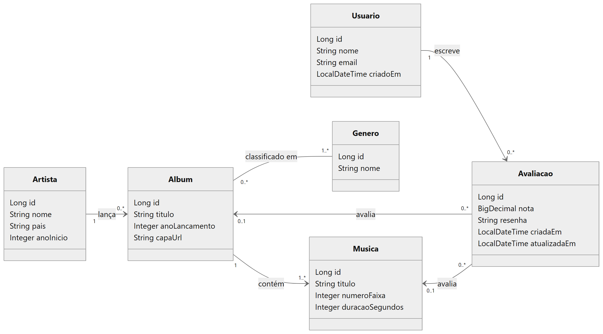
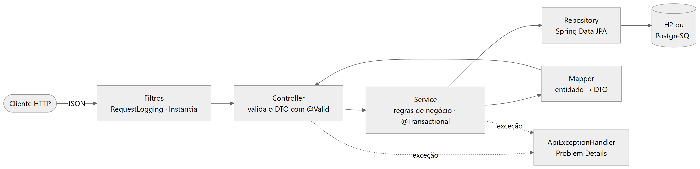
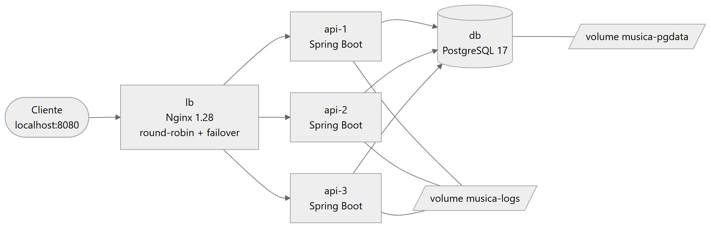

<!-- _class: titulo -->
<!-- _paginate: false -->

# API de Avaliação Musical

Uma API REST para avaliar álbuns e músicas, no modelo do Letterboxd

**Gabriel de Oliveira Rodrigues**
Backend 2026.2 · Tema: Entretenimento e Cultura

<span class="small">github.com/gabrieldorodrigues/apirest-2026 · gabrieldorodrigues.github.io/apirest-2026</span>

---

## Problema

- O streaming toca a música, mas guarda pouca opinião do ouvinte
- Avaliar um álbum inteiro é diferente de avaliar uma faixa
- Não existe um lugar central para registrar e comparar opiniões

**A API resolve isso com:**

- Catálogo: artistas, álbuns, músicas e gêneros
- Avaliações com **nota de 0,5 a 5** e resenha, de um álbum **ou** de uma música
- **Nota média** calculada para cada álbum e cada música
- Histórico de avaliações por usuário

---

## Stack

| Camada | Tecnologia |
| --- | --- |
| Linguagem e framework | Java 17 · Spring Boot 4.1.1 (Web MVC, Data JPA, Validation) |
| Banco | H2 em arquivo (padrão) · PostgreSQL 17 (profile `postgres`) |
| Documentação da API | springdoc-openapi 3.1.1 (Swagger UI e OpenAPI 3) |
| Observabilidade | Spring Boot Actuator · Micrometer |
| Testes | JUnit 5 · MockMvc · Testcontainers |
| Infraestrutura | Docker Compose · Nginx (load balancer) · 3 réplicas |
| CI/CD e docs | GitHub Actions · GHCR · MkDocs no GitHub Pages |

---

## Domínio: diagrama UML



---

## Relacionamentos e regras de negócio

<div class="cols">
<div>

| Relação | Tipo |
| --- | --- |
| Artista → Álbum | 1:N |
| Álbum → Música | 1:N |
| Álbum ↔ Gênero | **N:N** |
| Usuário → Avaliação | 1:N |
| Álbum → Avaliação | 1:N |
| Música → Avaliação | 1:N |

</div>
<div>

| Regra | Resposta |
| --- | --- |
| Nota fora de 0,5 a 5 | 400 |
| Nota fora do passo de 0,5 | 422 |
| Álbum **e** música (ou nenhum) | 422 |
| Usuário avalia o mesmo item 2 vezes | 409 |
| Faixa repetida no álbum | 409 |
| E-mail repetido | 409 |
| Remover registro com dependentes | 409 |

</div>
</div>

---

## Arquitetura em camadas



```text
com.example.musica
├── controller   endpoints REST, @Valid nos DTOs, anotações do Swagger
├── service      regras de negócio, @Transactional
├── repository   Spring Data JPA, consultas JPQL
├── dto          records de entrada (RequestDto) e saída (ResponseDto)
├── mapper       entidade → DTO
├── model        entidades JPA
├── exception    exceções de domínio + ApiExceptionHandler
└── config       seed, OpenAPI, CORS, filtros de log e de instância
```

---

## DTOs de entrada e saída

<div class="cols">
<div>

**Entrada:** validação com Bean Validation

```java
public record AvaliacaoRequestDto(
    @NotNull(message = "O usuário é obrigatório")
    Long usuarioId,
    Long albumId,
    Long musicaId,
    @NotNull(message = "A nota é obrigatória")
    @DecimalMin(value = "0.5", message = "A nota mínima é 0.5")
    @DecimalMax(value = "5.0", message = "A nota máxima é 5")
    BigDecimal nota,
    @Size(max = 2000)
    String resenha
) {}
```

</div>
<div>

**Saída:** a entidade JPA nunca sai da API

```java
public record AvaliacaoResponseDto(
    Long id,
    Long usuarioId,
    String usuarioNome,
    @JsonInclude(NON_NULL) Long albumId,
    @JsonInclude(NON_NULL) String albumTitulo,
    @JsonInclude(NON_NULL) Long musicaId,
    @JsonInclude(NON_NULL) String musicaTitulo,
    BigDecimal nota,
    String resenha,
    LocalDateTime criadaEm,
    LocalDateTime atualizadaEm
) {}
```

`id`, datas e `notaMedia` são gerados pela API

</div>
</div>

---

## Validação e tratamento de erros

<div class="cols">
<div>

`@RestControllerAdvice` → **Problem Details** (RFC 9457)

| Código | Quando |
| --- | --- |
| 400 | Bean Validation, JSON inválido, parâmetro inválido ou ausente, `sort` inexistente |
| 404 | `RecursoNaoEncontradoException` |
| 409 | `ConflitoException` e constraint do banco |
| 422 | `RegraNegocioException` |
| 500 | Qualquer outra; o stack trace fica só no log |

</div>
<div>

`POST /usuarios` com nome vazio e e-mail inválido

```json
{
  "title": "Erro de validação",
  "status": 400,
  "detail": "Um ou mais campos são inválidos",
  "instance": "/usuarios",
  "errors": {
    "nome": "O nome é obrigatório",
    "email": "O e-mail é inválido"
  }
}
```

</div>
</div>

---

## Paginação, filtros e ordenação

<div class="cols">
<div>

`page`, `size` e `sort` do Spring Data em todas as listagens, com filtros opcionais e combináveis:

```java
@Query("""
    select a from Avaliacao a
    where (:usuarioId is null or a.usuario.id = :usuarioId)
      and (:albumId is null or a.album.id = :albumId)
      and (:musicaId is null or a.musica.id = :musicaId)
      and (:notaMinima is null or a.nota >= :notaMinima)
    """)
Page<Avaliacao> buscar(Long usuarioId, Long albumId,
    Long musicaId, BigDecimal notaMinima, Pageable pageable);
```

</div>
<div>

`GET /albuns?page=0&size=2&sort=anoLancamento,desc`

```json
{
  "content": [
    { "id": 2, "titulo": "In Rainbows",
      "anoLancamento": 2007, "notaMedia": 4.0, "...": "..." },
    { "id": 1, "titulo": "OK Computer",
      "anoLancamento": 1997, "notaMedia": 4.75, "...": "..." }
  ],
  "page": { "size": 2, "number": 0,
            "totalElements": 4, "totalPages": 2 }
}
```

`GET /avaliacoes?usuarioId=1` → histórico do usuário
`sort` com campo inexistente → 400

</div>
</div>

---

<!-- _class: titulo -->

## Carta-desafio 8: relatório agregado por período

> Como **curador da plataforma**, quero obter **totais e contagens das avaliações feitas em um período**, para acompanhar o que os usuários estão ouvindo e avaliando: quantas avaliações foram feitas, qual a nota média e quais gêneros, álbuns e músicas mais movimentaram a plataforma.

Issue #19 · PR #20 · `GET /relatorios/avaliacoes?inicio=2026-09-01&fim=2026-11-30`

---

## Critérios de aceite

- **Relatório do período** (datas inclusivas, pela `criadaEm`): total, álbuns × músicas, nota média, usuários que avaliaram, distribuição das notas, por gênero, top 5 álbuns e top 5 músicas
- **Período validado:** data ausente ou inválida → **400**; início depois do fim ou período maior que 1 ano → **422**
- **Período vazio** → 200 com tudo zerado (não é erro)
- **Consulta eficiente, sem N+1:** número fixo de consultas, com teste provando
- **Funciona no H2 e no PostgreSQL**
- **Demonstrável com dados reais:** seed com avaliações de setembro a novembro
- Documentado no Swagger, no README e no MkDocs, com testes automatizados

Integração com o domínio: **nenhuma entidade nova**, só leitura de `Avaliacao`, `Album`, `Musica`, `Genero`, `Artista` e `Usuario`

---

## Carta no código: controller e service

<div class="cols">
<div>

`RelatorioController`

```java
@GetMapping("/avaliacoes")
public RelatorioAvaliacoesDto avaliacoes(
    @RequestParam
    @DateTimeFormat(iso = DateTimeFormat.ISO.DATE)
    LocalDate inicio,
    @RequestParam
    @DateTimeFormat(iso = DateTimeFormat.ISO.DATE)
    LocalDate fim) {
  return relatorioService.avaliacoes(inicio, fim);
}
```

Data mal formatada → `MethodArgumentTypeMismatchException` → 400

</div>
<div>

`RelatorioService`

```java
validarPeriodo(inicio, fim);
// datas inclusivas: [inicio 00:00, fim + 1 dia 00:00)
LocalDateTime de = inicio.atStartOfDay();
LocalDateTime ate = fim.plusDays(1).atStartOfDay();

private void validarPeriodo(LocalDate inicio, LocalDate fim) {
  if (inicio.isAfter(fim)) {
    throw new RegraNegocioException(
        "A data inicial (...) é depois da data final (...)");
  }
  if (fim.isAfter(inicio.plusYears(1))) {
    throw new RegraNegocioException(
        "O período do relatório pode ter no máximo 1 ano");
  }
}
```

</div>
</div>

---

## Carta no código: o banco faz as contas

<div class="cols">
<div>

`AvaliacaoRepository`: totais numa consulta só

```java
@Query("""
    select new com.example.musica.repository.ResumoPeriodo(
        count(a),
        coalesce(sum(case when a.album is not null
                     then 1 else 0 end), 0),
        coalesce(sum(case when a.musica is not null
                     then 1 else 0 end), 0),
        avg(a.nota),
        count(distinct a.usuario.id))
    from Avaliacao a
    where a.criadaEm >= :inicio and a.criadaEm < :fim
    """)
ResumoPeriodo resumoDoPeriodo(LocalDateTime inicio,
                              LocalDateTime fim);
```

</div>
<div>

Gênero da avaliação de música = gênero do álbum dela

```java
from Avaliacao a
left join a.musica m
join Album al on al.id = coalesce(a.album.id, m.album.id)
join al.generos g
group by g.id, g.nome
order by count(a) desc, g.nome
```

**5 consultas, sempre:** resumo, distribuição, por gênero, top álbuns, top músicas

Os DTOs são montados direto no JPQL (`select new ...`), sem carregar entidades

</div>
</div>

---

## Carta no código: sem N+1, com prova

```java
@Test
@DisplayName("Sem N+1: o relatório faz 5 consultas, com 9 ou com 29 avaliações no período")
void numeroFixoDeConsultas() throws Exception {
    assertEquals(5, consultasDoRelatorio());

    // mais 20 avaliações no período: 10 usuários novos avaliando um álbum e uma música cada
    for (int i = 1; i <= 10; i++) { ... }
    entityManager.flush();

    assertEquals(5, consultasDoRelatorio());   // estatísticas do Hibernate
}
```

**Mudanças no código que já existia:**

| Mudança | Por quê |
| --- | --- |
| `@PrePersist` só preenche `criadaEm` quando está vazia | O seed grava datas no passado; pela API nada muda |
| Seed com avaliações de setembro a novembro, em ordem | Períodos diferentes dão relatórios diferentes |
| Handler de `MissingServletRequestParameterException` | Parâmetro obrigatório ausente dava **500**; agora dá **400** |

---

## Demonstração

| Requisição | Resultado |
| --- | --- |
| `?inicio=2026-09-01&fim=2026-11-30` | 9 avaliações · média 4,44 · 3 usuários · OK Computer no topo |
| `?inicio=2026-10-01&fim=2026-10-31` | 3 avaliações, todas de álbuns |
| `?inicio=2026-11-01&fim=2026-11-30` | 4 avaliações, todas de músicas |
| `?inicio=2020-01-01&fim=2020-01-31` | 200, tudo zerado |
| `?inicio=2026-12-31&fim=2026-01-01` | 422: data inicial depois da final |
| `?inicio=2026-13-01&fim=2026-12-31` | 400: parâmetro inválido |
| `POST /avaliacoes` + relatório de hoje | O total aumenta em 1 |

Postman: pasta **05 - Relatório por período** · Swagger UI: seção **Relatórios**

---

## Requisitos extras

| Extra | Peso | O que foi feito |
| --- | --- | --- |
| Testes automatizados | 5% | 69 testes de integração com MockMvc, sem mocks |
| Swagger/OpenAPI | 5% | Exemplos, erros por endpoint e Swagger UI no GitHub Pages |
| Observabilidade | 5% | Health, info, métricas do domínio e logs por requisição |
| SGBD diferente do H2 | 5% | PostgreSQL 17, testado com Testcontainers |
| Docker/Compose | 5% | API + PostgreSQL com healthchecks, em 1 comando |
| Load balancer | 10% | Nginx + 3 réplicas, header `X-Instancia`, failover |
| CI/CD | 5% | GitHub Actions: testes em todo PR, imagem publicada no GHCR |

**40% implementados** (o limite na nota é 20%) · cada extra tem issue e PR próprios

---

## Infraestrutura e entrega contínua

<div class="cols">
<div>



`docker compose up --build`

</div>
<div>

**CI** (`ci.yml`), em todo PR e push na `main`:

1. `./mvnw verify`, com o PostgreSQL do Testcontainers
2. Build da imagem Docker
3. Na `main`: publicação em `ghcr.io/gabrieldorodrigues/apirest-2026`

**Documentação** (`docs.yml`):

- `OpenApiDocsTest` gera o `openapi.json`
- MkDocs + Swagger UI no GitHub Pages

</div>
</div>

---

<!-- _class: titulo -->
<!-- _paginate: false -->

# Perguntas

<span class="small">Repositório: github.com/gabrieldorodrigues/apirest-2026</span>
<span class="small">Documentação: gabrieldorodrigues.github.io/apirest-2026</span>
<span class="small">Swagger UI: gabrieldorodrigues.github.io/apirest-2026/swagger/</span>
